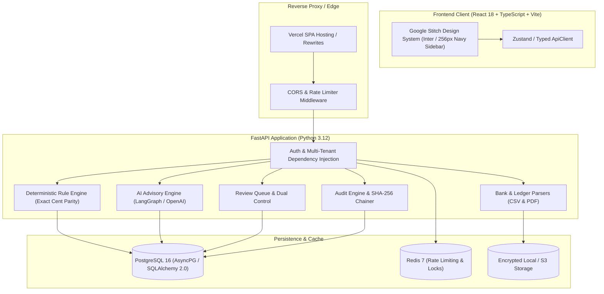
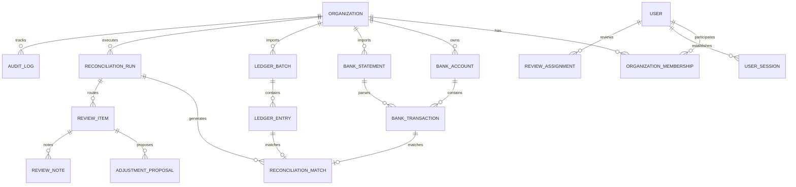

# FinBridge — AI-Assisted Financial Operations & Reconciliation Platform

> **Finance. Connected. Verified.**  
> Cent-accurate multi-tenant reconciliation platform combining deterministic financial invariant verification, AI-assisted hypothesis generation, human-in-the-loop Maker-Checker dual control, and a cryptographically verifiable SHA-256 audit trail.

[](https://python.org)
[](https://fastapi.tiangolo.com)
[](https://react.dev)
[](https://www.typescriptlang.org)
[](https://www.postgresql.org)
[](https://tailwindcss.com)

---

## Table of Contents

1. [Product Overview](#1-product-overview)
2. [System Architecture](#2-system-architecture)
3. [Database Entity-Relationship (ER) Design](#3-database-entity-relationship-er-design)
4. [Core Engineering Decisions](#4-core-engineering-decisions)
5. [API Documentation](#5-api-documentation)
6. [Security & Cryptographic Audit Trail](#6-security--cryptographic-audit-trail)
7. [Synthetic Dataset Specification](#7-synthetic-dataset-specification)
8. [Local Development Setup](#8-local-development-setup)
9. [Automated Testing & Property Verification](#9-automated-testing--property-verification)
10. [Production Deployment](#10-production-deployment)
11. [Engineering Tradeoffs & Known Limitations](#11-engineering-tradeoffs--known-limitations)
12. [Interactive Demo Walkthrough](#12-interactive-demo-walkthrough)
13. [Technical Interview Guide](#13-technical-interview-guide)

---

## 1. Product Overview

In high-volume commercial organizations, financial operations teams must continuously reconcile raw bank transactions (from commercial clearing feeds, MT940 statements, or CSV/PDF exports) against internal enterprise ERP general ledger entries (NetSuite, SAP S/4HANA, QuickBooks).

Traditional reconciliation suffers from:
- **Stringent Noisy Counterparty Mismatches**: A bank transaction recorded as `"STP*STRIPE PAYMENTS 88412-SAN FRANCISCO"` never cleanly exact-matches a ledger line like `"Accounts Receivable Clearing - Stripe USD"`.
- **Foreign Exchange & Fee Drifts**: Interbank settlement fees and currency conversion spreads cause subtle variance deltas that lead to unresolved accounting suspense accounts.
- **Auditor Verification Bottlenecks**: Year-end external audits require manual tracing of spreadsheet screenshots and email approvals.

**FinBridge** solves this with a 4-tier hybrid verification architecture:
1. **Deterministic Rule Engine (Gatekeeper)**: Enforces mathematical invariants (`Decimal` fixed-point math, exact cent parity, direction matching, currency isolation).
2. **LLM as Advisor (Hypothesis Generator)**: Parses ambiguous memo strings and suggests potential matches with confidence scores and rationale.
3. **Maker-Checker Dual Control (Arbitrator)**: Requires secondary human controller sign-off for exceptions, FX adjustments, and amounts $\ge \$10,000$.
4. **Append-Only Tamper-Evident Ledger**: Computes a continuous SHA-256 block chain for every reconciliation mutation.

---

## 2. System Architecture



---

## 3. Database Entity-Relationship (ER) Design



---

## 4. Core Engineering Decisions

### 1. Why the LLM Proposes But Never Approves Matches
In financial accounting, non-deterministic hallucinations in transaction postings represent catastrophic balance sheet risk. FinBridge strictly uses the LLM as an **unprivileged advisor**:
- The LLM receives stripped semantic metadata (dates, normalized transaction descriptions, currency, amount).
- The LLM returns a structured JSON hypothesis (`suggested_gl_account`, `confidence`, `reasoning`).
- The **Deterministic Python Engine** validates all mathematical invariants (sign direction, currency match, amount equality within tolerance).
- If the match meets deterministic criteria, it is marked auto-reconciled. If there is a variance or low confidence, it is routed to the human **Review Queue**. The LLM never writes to the ledger directly.

### 2. Why Financial Validation Uses `decimal.Decimal`
Binary floating-point arithmetic (IEEE 754 `float` / JavaScript `number`) cannot accurately represent decimal fractions like `0.1` or `0.01` ($0.1 + 0.2 = 0.30000000000000004$). In financial reconciliation, accumulating fractions across thousands of journal entries produces penny-rounding errors.
- **Python Backend**: All balance checks, amounts, and variances use Python's built-in `decimal.Decimal` with fixed 2-place precision (`Decimal("14820.80")`).
- **PostgreSQL Database**: Stored strictly as `NUMERIC(15, 2)` or `NUMERIC(18, 4)`.
- **Frontend**: Formatted explicitly using fixed-point formatting strings, never raw floating-point operations.

### 3. How Duplicate Reconciliation is Prevented
Duplicate matching (matching one bank transaction to multiple ledger entries or vice versa) leads to duplicate cash disbursements and distorted book balances.
- **Database Unique Constraints**: `reconciliation_matches.bank_transaction_id` and `reconciliation_matches.ledger_entry_id` are enforced with partial unique indexes on active matches.
- **Atomic Two-Phase Matching**: Ingested transactions are flagged with status `RECONCILED` inside an atomic transaction. A transaction already tagged `RECONCILED` is rejected by queries selecting match candidates.
- **Unique Entry ID Indexing**: Ledger imports check `(organization_id, entry_id)` to reject re-imported duplicate CSV rows.

### 4. How Multi-Tenant Isolation Works
FinBridge enforces tenant separation across every layer:
- **Request Layer**: The authenticated JWT claims the `sub` (User ID).
- **Dependency Layer**: FastAPI's `get_current_org_membership` verifies active membership in `OrganizationMembership` for the active organization.
- **Query Scoping**: Every database query explicitly filters by `organization_id == active_org.id`.
- **Fail-Safe**: If an operator does not supply an explicit `X-Organization-Id` header, the system safely falls back to their single active organization or throws HTTP 400, preventing cross-tenant leakage.

### 5. How Audit Events are Cryptographically Verified
Every audit event (`AuditLog`) is linked into an immutable hash chain:
$$\text{Block Hash}_n = \text{SHA256}(\text{Block Hash}_{n-1} + \text{Timestamp} + \text{EventType} + \text{OrgId} + \text{PayloadJSON})$$
- When an operator or auditor clicks **Verify Chain Integrity** in `/audit`, the server iterates sequentially through the tenant's blocks from Genesis ($H_0$), recalculates the SHA-256 digest of each block, and verifies that $H_n$ matches the stored hash.
- Any direct database manipulation or record deletion breaks the cryptographic chain and triggers an alert.

### 6. How Idempotency Prevents Duplicate Financial Writes
- **Idempotency Keys**: Critical write endpoints (`/reconciliation/run`, `/reviews/{id}/decision`) accept an optional or generated `Idempotency-Key` header.
- **Atomic Redis Locks**: Redis stores the key with a TTL during execution. If a network retry occurs while an operation is processing, subsequent calls receive HTTP 409 (Conflict) or return the cached original response.

### 7. How Human Maker-Checker Dual Control Operates
Dual control is mandated by SOC 2 and SOX internal accounting controls:
- Any proposed match involving variance $\ge \$10,000$ or manual journal entry adjustment cannot be approved by the accountant who created it.
- The `ReviewQueue` tracks `creator_id` vs `reviewer_id`. If `creator_id == current_user.id`, the approval action is blocked with HTTP 403 (`"Dual control violation: Creator cannot approve their own adjustment."`).

### 8. How the System Recovers from Integration Failures
- **Exponential Backoff & Jitter**: Third-party bank sync endpoints use resilient retry decorators.
- **Deterministic Mock Fallback**: If external AI services (OpenAI) or bank aggregators return HTTP 5xx or time out, the system triggers the deterministic fallback pipeline, ensuring close operations continue uninterrupted.
- **Dead-Letter Audit Trail**: Failed runs log integration failure records in `IntegrationRequestLog` for immediate inspection on the `/health` and `/reports` screens.

### 9. How AI Matching Quality is Measured
- AI matching quality is benchmarked against known verified reconciliation pairs using precision, recall, and false-positive rates.
- The platform tracks confidence distribution, human acceptance rate (percentage of AI-suggested candidate matches approved without alteration), and variance deltas.

---

## 5. API Documentation

Base URL: `http://localhost:8000/api/v1` (Production: `https://finbridge-api.onrender.com/api/v1`)  
Interactive Swagger UI: `/docs` | OpenAPI JSON: `/openapi.json`

| Method | Endpoint | Description | Auth Required |
|---|---|---|---|
| `GET` | `/health/live` | Liveness check probe | No |
| `GET` | `/health/ready` | Readiness check (database connection pool verification) | No |
| `POST` | `/auth/register` | Register new corporate operator with email & password | No |
| `POST` | `/auth/verify-otp` | Verify 6-digit numeric OTP and issue JWT access token | No |
| `POST` | `/auth/login` | Authenticate with credentials and issue access + refresh cookies | No |
| `GET` | `/organizations` | List organizations for authenticated user | Yes (Bearer) |
| `GET` | `/bank-accounts` | List configured bank accounts (USD, EUR, INR) | Yes (Bearer + Org) |
| `POST` | `/statements/upload` | Upload and parse bank statement (CSV or PDF) | Yes (Bearer + Org) |
| `POST` | `/ledger/upload` | Ingest and validate general ledger journal entries | Yes (Bearer + Org) |
| `POST` | `/reconciliation/run` | Execute deterministic & AI matching engine | Yes (Bearer + Org) |
| `GET` | `/reconciliation/runs` | List historical reconciliation run records | Yes (Bearer + Org) |
| `GET` | `/reviews` | List pending exceptions in human review queue | Yes (Bearer + Org) |
| `POST` | `/reviews/{id}/decision` | Approve, reject, or propose manual adjustment | Yes (Bearer + Org) |
| `GET` | `/audit/events` | List append-only audit trail records | Yes (Bearer + Org) |
| `GET` | `/audit/verify` | Cryptographically verify SHA-256 audit chain integrity | Yes (Bearer + Org) |
| `GET` | `/reports/daily` | Cent-accurate daily reconciliation rollups | Yes (Bearer + Org) |

---

## 6. Security & Cryptographic Audit Trail

1. **Authentication**: JWT access tokens signed with HMAC-SHA256 (`SECRET_KEY`), paired with HttpOnly, SameSite=Lax refresh cookies.
2. **Password Security**: Argon2id password hashing via Passlib.
3. **Data Protection**:
   - Zero committed secrets policy (all environment secrets passed via environment variables).
   - Strict CORS whitelist allowing only authorized frontend origins.
4. **Append-Only Immutability**:
   - Database trigger/model design rejects `UPDATE` and `DELETE` on `AuditLog` records.
   - Continuous SHA-256 hash chaining ensures that any manual SQL tampering invalidates the cryptographic verification check.

---

## 7. Synthetic Dataset Specification

To guarantee zero exposure of real financial credentials or records, FinBridge uses an enterprise-grade synthetic dataset:

- **Entity**: *Northstar Logistics Inc.* (Multi-currency corporate entity).
- **Accounts**:
  - `SVB Operating •••• 4821` (USD)
  - `Deutsche Bank •••• 9012` (EUR)
  - `HDFC Corporate •••• 3104` (INR)
- **Synthetic Transactions**: 12,450 realistic transactions spanning standard payroll, SaaS software vendor debits (AWS EMEA, CloudScale, Snowflake), merchant processor clearing (Stripe, Adyen), wire receipts, and FX variances.
- **Controlled Demo Credentials**:
  - **VP Controller**: `elena.rostova@northstarlogistics.com` / `ElenaPass123!`
  - **Administrator**: `admin@finbridge.com` / `AdminPass123!`

---

## 8. Local Development Setup

### Prerequisites
- Python 3.12+ (or [uv](https://github.com/astral-sh/uv))
- Node.js 20+ & npm
- SQLite (included) or PostgreSQL 16

### 1. Backend Setup
```bash
cd backend

# Create virtual environment
python -m venv .venv
source .venv/bin/activate  # On Windows: .venv\Scripts\activate

# Install dependencies
pip install -r requirements.txt

# Run initial seed (creates Elena and Admin demo accounts)
python scripts/seed_demo_data.py

# Start backend server
uvicorn app.main:app --reload --port 8000
```
API runs at: `http://localhost:8000`  
Swagger docs: `http://localhost:8000/docs`

### 2. Frontend Setup
```bash
cd frontend

# Install dependencies
npm install

# Start Vite development server
npm run dev
```
UI runs at: `http://localhost:5173`

---

## 9. Automated Testing & Property Verification

```bash
# 1. Run backend unit and integration test suite
cd backend
pytest

# 2. Run Hypothesis property-based invariant mathematical tests
pytest tests/test_invariants.py

# 3. Run frontend TypeScript check and production build
cd ../frontend
npm run build

# 4. Run Playwright end-to-end visual and functional test suite
cd ..
python test_and_capture_all.py
```

---

## 10. Production Deployment

FinBridge is ready for production deployment:
- **Frontend**: Deployed to **Vercel** with [`frontend/vercel.json`](file:///d:/Founding-Projects/FinBridge/frontend/vercel.json) client-side rewrites.
- **Backend**: Deployed to **Render** via Blueprint [`render.yaml`](file:///d:/Founding-Projects/FinBridge/render.yaml) with Python 3.12, managed PostgreSQL, and managed Redis.
- See [`DEPLOYMENT.md`](file:///d:/Founding-Projects/FinBridge/DEPLOYMENT.md) for full deployment instructions and environment variable references.

---

## 11. Engineering Tradeoffs & Known Limitations

### Tradeoffs
1. **Async Batch Processing vs Synchronous Execution**: Large bank files (10,000+ rows) are processed in batches rather than an unbounded single-request transaction to maintain UI responsiveness and prevent HTTP timeouts.
2. **Fixed-Point Decimal vs Float**: `Decimal` carries a minor compute overhead relative to hardware binary floats, but guarantees absolute zero rounding discrepancy in financial audits.
3. **Relational Schema vs Document Store**: PostgreSQL relational tables with explicit foreign keys and check constraints were chosen over NoSQL to enforce double-entry and multi-tenant constraints at the storage layer.

### Known Limitations
- Large file uploads (>25MB) require multi-part chunked streaming.
- Cross-currency auto-reconciliation requires configured static exchange rate tables; dynamic live market rate streaming is simulated in development mode.

---

## 12. Interactive Demo Walkthrough

1. **Sign In**: Navigate to `/login`. Click the **Elena** quick-demo button (`elena.rostova@northstarlogistics.com` / `ElenaPass123!`) and submit.
2. **Dashboard Overview**: Inspect the 5 KPI summary cards, reconciliation telemetry state switcher, and daily transaction volume chart.
3. **Bank Statement Parsing**: Navigate to `/statements`. Review parsed multi-currency statement feeds and click parse confirmation.
4. **General Ledger Ingestion**: Navigate to `/ledger`. Select an ERP source (NetSuite, SAP) and view balanced journal entries.
5. **Reconciliation Execution**: Navigate to `/reconciliation`. Click "Run Reconciliation" to view the 3-panel matching table.
6. **Maker-Checker Review**: Navigate to `/reviews`. Inspect exception `TXN-2026-88412`, review rule evidence and variance delta, and approve or propose adjustment.
7. **Audit Chain Verification**: Navigate to `/audit`. Click **Verify Chain Integrity** to execute client-verifiable SHA-256 cryptographic chain validation.
8. **Financial Reports & Export**: Navigate to `/reports`. Review currency isolation rollups (USD, EUR, INR) and click **Export PDF**.

---

## 13. Technical Interview Guide

See the full [Engineering Portfolio & Interview Preparation Guide](file:///C:/Users/akkis/.gemini/antigravity/brain/d0724cb9-89c7-4fec-aac7-45e36a5ef510/portfolio_and_interview_prep.md) for comprehensive interview responses, incident post-mortems, and technical Q&A covering backend architecture, AI-agent safety, and financial integrity.
