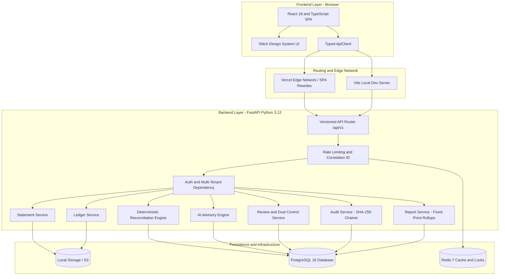
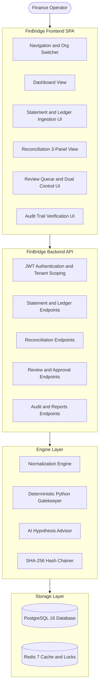
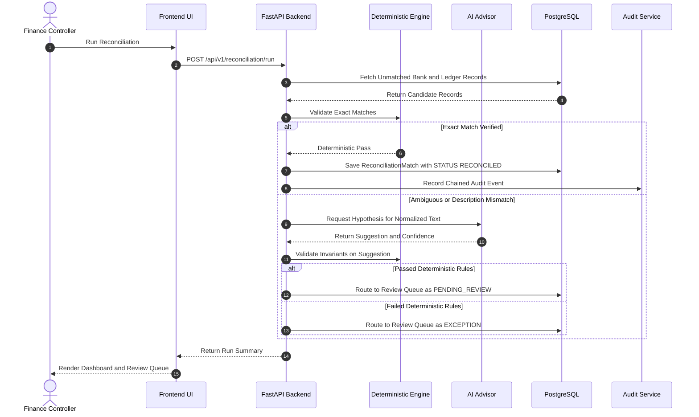
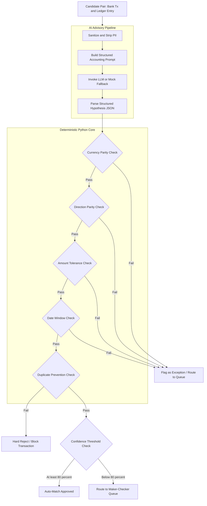
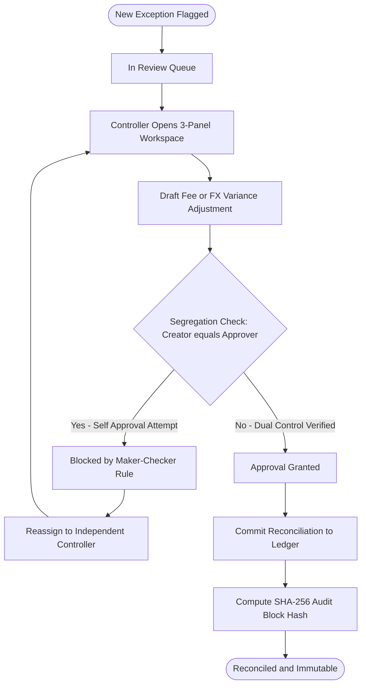
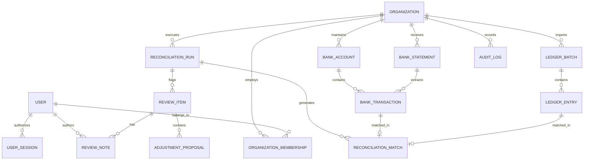

# FinBridge — AI-Assisted Financial Operations & Reconciliation Platform

> **Finance. Connected. Verified.**  
> *"LLM proposes. Python verifies. Finance teams approve exceptions."*

FinBridge is an enterprise-grade financial operations and reconciliation platform. It bridges commercial bank clearing feeds (CSV and PDF) with enterprise general ledger systems (NetSuite, SAP S/4HANA, QuickBooks) using a hybrid verification architecture: probabilistic AI models propose matching hypotheses, an unprivileged deterministic Python core enforces exact cent-parity arithmetic, human controllers arbitrate exceptions via Maker-Checker dual control, and an append-only SHA-256 cryptographic hash chain guarantees tamper-evident auditability.

[](https://python.org)
[](https://fastapi.tiangolo.com)
[](https://react.dev)
[](https://www.typescriptlang.org)
[](https://www.postgresql.org)
[](https://tailwindcss.com)
[](https://vitejs.dev)

---

## Table of Contents

1. [Project Introduction](#1-project-introduction)
2. [Problem Statement — Why Are We Building This?](#2-problem-statement--why-are-we-building-this)
3. [Our Solution — What FinBridge Builds](#3-our-solution--what-finbridge-builds)
4. [System Architecture](#4-system-architecture)
5. [End-to-End Transaction Processing Pipeline](#5-end-to-end-transaction-processing-pipeline)
6. [Architecture & Data Flow Diagrams](#6-architecture--data-flow-diagrams)
7. [Technology Stack — Why We Use It](#7-technology-stack--why-we-use-it)
8. [Repository Structure](#8-repository-structure)
9. [Database Design](#9-database-design)
10. [API Documentation](#10-api-documentation)
11. [Financial Safety and Security](#11-financial-safety-and-security)
12. [Installation and Local Setup](#12-installation-and-local-setup)
13. [Environment Variables](#13-environment-variables)
14. [How to Use FinBridge — User Journey](#14-how-to-use-finbridge--user-journey)
15. [Testing and Quality Assurance](#15-testing-and-quality-assurance)
16. [Deployment Architecture](#16-deployment-architecture)
17. [Detailed Example Scenario](#17-detailed-example-scenario)
18. [Current Status and Roadmap](#18-current-status-and-roadmap)
19. [Engineering Decisions and Trade-offs](#19-engineering-decisions-and-trade-offs)
20. [Security & Verification Summary](#20-security--verification-summary)

---

## 1. Project Introduction

### Name & Category
- **Project Name**: FinBridge
- **Tagline**: *Finance. Connected. Verified.*
- **Category**: AI Financial Operations & Reconciliation Platform
- **Core Philosophy**:  
  $$\text{"LLM proposes. Python verifies. Finance teams approve exceptions."}$$

### Who It Is Built For
FinBridge is built for:
- **Corporate Controllers and VP Controllers** closing monthly books across multiple operating subsidiaries and banking institutions.
- **Accounting & Financial Operations Teams** managing high volumes of daily disbursements, customer wire receipts, merchant payouts, and vendor invoices.
- **Internal & External Audit Teams** (SOC 2, SOX 404, statutory financial audits) requiring mathematical, immutable evidence that cash ledger balances match verified bank statements.

### Financial Operations Supported
1. **Multi-Source Bank Feed Ingestion**: Ingests and normalizes statement transactions from commercial clearing banks across USD, EUR, and INR.
2. **ERP General Ledger Ingestion**: Ingests journal entries from ERPs (NetSuite, SAP S/4HANA, QuickBooks Online), enforcing double-entry balance validation ($\sum \text{Debits} == \sum \text{Credits}$).
3. **Deterministic Rule-Based Matching**: Sub-second matching of transactions using exact amount parity, direction matching, date window tolerances, and reference key equivalence.
4. **AI-Assisted Ambiguity Resolution**: Semantic matching of unstructured, truncated bank statement descriptors against ERP vendor/customer ledger lines with confidence scoring.
5. **Maker-Checker Human Review Queue**: Structured approval workflow enforcing segregation of duties on variance adjustments and high-value transactions.
6. **Append-Only Cryptographic Audit Trail**: Continuous SHA-256 block hash chaining of every state transition, adjustment, and reconciliation match.
7. **Multi-Currency Analytics & Reporting**: Fixed-point rollups providing daily and monthly reconciliation velocity, unmatched aging summaries, and fee leakage tracking.

---

## 2. Problem Statement — Why Are We Building This?

### 1. Who Experiences These Problems?
Mid-market companies and enterprises with $\$10\text{M} - \$500\text{M}+$ in annual gross transaction volume. These organizations typically operate multiple bank accounts (operating checking, payroll, merchant clearing) across different currencies while maintaining an internal ERP general ledger.

### 2. What the Existing Manual Process Looks Like
At the end of every business day or fiscal month:
1. Staff accountants log into multiple online banking portals (e.g. JPMorgan Chase, Silicon Valley Bank, Deutsche Bank) to manually download CSV or PDF statements.
2. The team exports general ledger journal entries from NetSuite or SAP into spreadsheets.
3. Accountants spend days running Excel `VLOOKUP`, `XLOOKUP`, or fuzzy macro scripts to align bank rows with ledger rows.
4. When transaction strings do not match, accountants manually message account executives or vendors over Slack or email to verify counterparty identity.
5. Variances (bank wire fees, credit card interchange, FX spreads) are manually entered as balancing journal entries in the ERP.
6. Documentation is captured via spreadsheet screenshots and stored in shared drives for auditors.

### 3. Why Existing Workflows Are Inefficient
- **Inconsistent, Truncated Strings**: Bank feeds truncate descriptions to 30-40 characters, inject clearing intermediary codes, or use cryptic acronyms (e.g., `"STP*STRIPE PAYMENTS 88412-SF"` vs. `"Accounts Receivable Clearing - Stripe USD"`). Exact-string lookups fail on over 40% of records.
- **Timing and Settlement Delays**: ACH and wire transactions take 1 to 3 business days to settle, causing date drift between ERP invoice creation and bank posting.
- **Fee and FX Divergence**: A bank statement line of $\$9,975.00$ often corresponds to a $\$10,000.00$ invoice due to a $\$25.00$ outgoing wire fee. Rule-based exact amount matching fails completely on these pairs.
- **Month-End Crunch**: Manual matching consumes up to 5-10 business days per month-end close, preventing finance teams from delivering timely operational analytics.

### 4. What Financial Risks Occur?
- **Unreconciled Cash Discrepancies**: Hidden cash leaks, duplicate vendor disbursements, or uncollected customer receivables go unnoticed for months.
- **Material Weaknesses in Financial Controls**: Failing SOX 404 or SOC 2 compliance due to unverified adjustments and lack of Maker-Checker segregation.
- **Audit Deficiencies & Escalated Fees**: External auditors cannot reconstruct the lineage of spreadsheet adjustments, resulting in expensive audit delays and restatements.

### 5. Why Automation Alone (or Pure AI) Is Not Enough
- **Traditional Rule Engines Are Fragile**: Strict rules break when memos change by a single punctuation mark or when settlement dates cross a weekend.
- **Pure LLM / Autonomous AI Agents Are Unacceptable in Finance**: LLMs are probabilistic token generators. Giving an autonomous LLM agent the capability to directly post journal entries or balance accounts creates severe financial risk. An LLM that is 99% accurate will introduce 10 material errors across 1,000 transactions, corrupting the general ledger.
- **The FinBridge Solution**: Pair an unprivileged LLM for **hypothesis generation** with a deterministic Python engine that enforces **mathematical invariants**, backed by **human controller approval** on exceptions.

---

## 3. Our Solution — What FinBridge Builds

FinBridge transforms reconciliation into a disciplined, automated, and auditable 4-stage pipeline:

```
┌─────────────────────────────────────────────────────────────────────────────┐
│                          FinBridge Core Philosophy                          │
│                                                                             │
│  [1. External Feeds] ──> [2. LLM Proposes] ──> [3. Python Verifies] ──> [4. Finance Approves]  │
│    Bank CSV / PDF          Ambiguity Parser       Deterministic Core        Maker-Checker       │
│    ERP Ledger CSV          Hypothesis Only         Exact Cent Parity        Dual Control        │
│                            No Direct Writes        Zero Floats Allowed      Audit-Locked        │
└─────────────────────────────────────────────────────────────────────────────┘
```

### Major Platform Capabilities

1. **Bank Statement Ingestion**: Parses multi-format CSV and PDF statements, extracting date, description, debit, credit, currency, and reference metadata.
2. **Ledger Data Ingestion**: Ingests ERP journal entries, validating required double-entry accounting attributes (Journal ID, Account Code, Source ERP).
3. **Transaction Normalization**: Formats disparate date formats (`YYYY-MM-DD`, `MM/DD/YYYY`), normalizes counterparty strings, strips whitespace, and standardizes signs.
4. **Candidate Matching Engine**: High-speed filtering evaluating amount equivalence, booking date windows (configurable $\pm 3$ to $\pm 7$ days), and token similarity.
5. **AI-Assisted Matching (LangGraph + OpenAI)**: Evaluates unmatched candidate pairs with unstructured text, generating a structured hypothesis with confidence score ($0.0 - 1.0$) and plain-English financial reasoning.
6. **Deterministic Financial Validation**: Evaluates 5 mathematical gatekeeper rules:
   - Currency isolation (e.g. USD matches only USD).
   - Sign/direction parity (Bank Credit matches Ledger Debit; Bank Debit matches Ledger Credit).
   - Cent-accurate amount equality within defined tolerance.
   - Duplicate prevention (a transaction cannot be matched more than once).
   - Accounting period lock verification.
7. **Automated Exception Detection**: Flags unmatched transactions, fee variances, FX spreads, and low-confidence pairings.
8. **Maker-Checker Human Review Queue**: Provides a 3-panel side-by-side reconciliation workspace where controllers review evidence and approve or reject matches.
9. **Tamper-Evident Audit Trail**: Every user decision, run execution, and ledger confirmation is hashed into an append-only SHA-256 chain.
10. **Financial Rollups & PDF Export**: Provides exact rollups across currencies with built-in printable audit report generation.
11. **Integration Reliability Simulator**: Built-in test harness for webhook failures, bank timeout retries, and circuit breaker behavior.

> [!IMPORTANT]
> **Core Invariant**: An AI confidence score alone **never** authorizes a financial match or GL posting. It only informs prioritization within the review queue.

---

## 4. System Architecture



### Architectural Layer Responsibilities

| Layer | Technologies | Responsibilities |
|---|---|---|
| **Frontend** | React 18, TypeScript, Tailwind CSS, Vite | Responsive UI matching Stitch specifications, client-side session management, state switcher, print stylesheet formatting. |
| **API Gateway** | FastAPI, Starlette, Pydantic v2 | Request validation, correlation ID tracking, rate limiting, exception handling with guaranteed CORS headers. |
| **Authentication & Multi-Tenancy** | PyJWT, Argon2id, FastAPI Dependencies | Token extraction, role-based access control (`ADMIN`, `CONTROLLER`, `ACCOUNTANT`, `AUDITOR`), active organization isolation. |
| **Document Ingestion** | Python `csv`, `pdfplumber`, `pandas` | Streaming file validation, tabular PDF bounding-box extraction, column header mapping, syntax validation. |
| **Matching & Invariants** | Python `decimal.Decimal`, `rapidfuzz` | Exact mathematical validation, rule execution, candidate scoring, double-entry balance verification. |
| **AI Advisory Pipeline** | OpenAI API (`gpt-4o-mini`), LangGraph | Prompt sanitization, PII redaction, structured hypothesis extraction, deterministic mock fallback. |
| **Persistence** | PostgreSQL 16 (or SQLite in dev), SQLAlchemy 2.0 Async, Alembic | Async relational persistence, partial unique indexing, foreign key cascade constraints, schema migrations. |
| **Caching & Reliability** | Redis 7 | Distributed idempotency locks, sliding-window rate limit counters, session revocation storage. |

---

## 5. End-to-End Transaction Processing Pipeline

Below is the 10-step lifecycle of every transaction processed in FinBridge:

```
[1. Upload] ──> [2. Extract] ──> [3. Normalize] ──> [4. Ledger Import] ──> [5. Candidate Pair]
                                                                                   │
[10. Audit/Report] <── [9. Human Review] <── [8. Exception] <── [7. Validate] <── [6. AI Advise]
```

### Detailed Pipeline Steps

#### Step 1: Bank Statement Upload
- **What Happens**: The user uploads a bank statement (CSV or PDF) for a specific bank account. The system validates file extension, MIME type, and size ($\le 25\text{MB}$).
- **Why It Is Necessary**: Raw statements must be recorded with tenant provenance before parsing begins.
- **Technology**: FastAPI multipart form handling, `app/services/ingestion/statement_service.py`.
- **Input**: Multipart file binary, `bank_account_id` UUID, `X-Organization-Id`.
- **Output**: `BankStatement` record in database (status: `PENDING`), file persisted to storage.

#### Step 2: Data Extraction
- **What Happens**: Parses the file into raw rows. For CSVs, headers like `Date`, `Description`, `Amount`, `Balance` are mapped. For PDFs, `pdfplumber` extracts table bounding boxes.
- **Why It Is Necessary**: Financial institutions format tables differently; raw data must be converted into structured Python dictionaries.
- **Technology**: `pdfplumber`, Python `csv.DictReader`, `app/services/ingestion/csv_parser.py`, `pdf_parser.py`.
- **Input**: Saved statement file on disk.
- **Output**: List of unparsed row dictionaries containing raw strings.

#### Step 3: Normalization
- **What Happens**: Raw dates are converted to ISO 8601 `YYYY-MM-DD`. Amounts are parsed into `Decimal` instances. Debits (outflows) and Credits (inflows) are assigned signs matching double-entry cash accounts. Whitespace and non-printable characters are stripped from memos.
- **Why It Is Necessary**: Downstream mathematical matching cannot compare heterogeneous formats.
- **Technology**: Python `datetime`, `decimal.Decimal`, `app/services/ingestion/normalizer.py`.
- **Input**: Raw string dictionaries.
- **Output**: Validated `BankTransaction` records in database with status `UNMATCHED`.

#### Step 4: Ledger Import
- **What Happens**: General ledger journal entries are ingested from ERP CSV exports. Double-entry integrity is verified ($\sum \text{Debits} == \sum \text{Credits}$ across the batch). Duplicate entry IDs are rejected.
- **Why It Is Necessary**: Reconciliation requires both sides of the balance sheet. Importing invalid or unbalanced ledger batches would corrupt downstream matching.
- **Technology**: `app/services/ingestion/ledger_service.py`, `ledger_parser.py`.
- **Input**: ERP journal CSV file, `source_system` string (`NetSuite`, `SAP`, `QuickBooks`).
- **Output**: `LedgerBatch` and child `LedgerEntry` records in database.

#### Step 5: Candidate Generation
- **What Happens**: The engine queries unmatched bank transactions and unmatched ledger entries within a configurable date window (default: $\pm 5$ days) for the same currency. Candidate pairs are filtered based on sign opposition (Bank Debit $\leftrightarrow$ Ledger Credit).
- **Why It Is Necessary**: Avoids an $O(N \times M)$ cross-product comparison across thousands of records.
- **Technology**: SQLAlchemy async filtered joins, `app/services/reconciliation/engine.py`.
- **Input**: Active `organization_id`, date range.
- **Output**: List of potential match candidate tuples `(bank_tx, ledger_entry)`.

#### Step 6: AI-Assisted Matching
- **What Happens**: For candidate pairs where text strings differ, sanitized transaction metadata is passed to the AI pipeline. The LLM evaluates merchant names, invoice prefixes, and counterparty abbreviations, returning a suggested match with confidence score ($0.0 - 1.0$) and explanation.
- **Why It Is Necessary**: Resolves counterparty abbreviations that rule-based exact string matching fails on.
- **Technology**: LangGraph, OpenAI `gpt-4o-mini`, `app/services/ai/ai_reconciliation_service.py`.
- **Input**: Sanitized JSON containing normalized descriptions, amounts, dates.
- **Output**: Structured Pydantic hypothesis: `{match: bool, confidence: float, reasoning: str}`.

#### Step 7: Deterministic Financial Validation
- **What Happens**: The hypothesis is passed through the deterministic gatekeeper. The engine executes mathematical invariant rules:
  1. `RULE_CURRENCY_PARITY`: Currency strings must match exactly.
  2. `RULE_DIRECTION_PARITY`: Bank Credit must pair with Ledger Debit, and vice-versa.
  3. `RULE_AMOUNT_EQUALITY`: Absolute difference $|Amount_{\text{bank}} - Amount_{\text{ledger}}| \le \text{tolerance}$.
  4. `RULE_DATE_WINDOW`: Date delta $\le$ allowed window.
  5. `RULE_NO_DUPLICATE`: Neither ID has already been reconciled.
- **Why It Is Necessary**: Guarantees mathematical accuracy and eliminates LLM hallucinations before records are touched.
- **Technology**: `app/services/reconciliation/rules.py`, `engine.py`.
- **Input**: Candidate pair, AI hypothesis, organization configuration.
- **Output**: `ValidationResult(is_valid=True/False, rule_results=[...])`.

#### Step 8: Exception Management
- **What Happens**: Pairs that fail deterministic checks (e.g., amount mismatch due to wire fees, missing ledger counterpart, ambiguous AI confidence $< 0.80$) are flagged as exceptions and routed to the Review Queue.
- **Why It Is Necessary**: Exceptions must be separated from auto-matched pairs so accountants can review variance deltas.
- **Technology**: `app/services/reconciliation/reconciliation_service.py`.
- **Input**: Failed validation candidate pairs.
- **Output**: `ReviewItem` records in database with categorized exception tags (`FX_VARIANCE`, `BANK_FEE`, `UNMATCHED`).

#### Step 9: Human Review & Dual Control
- **What Happens**: The human controller opens the 3-panel review workspace (`ReviewQueuePage.tsx`), inspects the bank row, proposed ledger row, AI reasoning, and variance deltas. The controller approves, rejects, or enters an adjustment proposal (e.g., allocating a $\$25.00$ bank fee). Maker-Checker enforces that the creator cannot approve their own adjustment.
- **Why It Is Necessary**: Ensures human oversight and regulatory compliance for high-value transactions.
- **Technology**: `app/services/review/review_service.py`, `frontend/src/pages/ReviewQueuePage.tsx`.
- **Input**: Decision payload (`APPROVE`, `REJECT`, `ADJUST`), operator ID, adjustment journal details.
- **Output**: `ReconciliationMatch` created, `ReviewItem` marked `RESOLVED`.

#### Step 10: Audit & Reporting
- **What Happens**: The approved match triggers an immutable audit log entry. The block's SHA-256 hash is computed using the previous block's hash. Reports roll up reconciled amounts, match velocity, and fee losses.
- **Why It Is Necessary**: External auditors require tamper-evident proof of every accounting event.
- **Technology**: `app/services/audit/audit_service.py`, `app/services/reports/report_service.py`.
- **Input**: Match execution context, operator ID, timestamp.
- **Output**: `AuditLog` row with cryptographic hash, updated dashboard and report metrics.

---

## 6. Architecture & Data Flow Diagrams

### A. High-Level System Architecture



---

### B. Bank-to-Ledger Reconciliation Flow



---

### C. AI-Assisted Matching & Deterministic Validation Flow



---

### D. Human Approval & Audit Flow



---

## 7. Technology Stack — Why We Use It

| Technology | Responsibility | Why We Chose It | Where It Is Used |
|---|---|---|---|
| **Python 3.12** | Core Backend Language | Strong typing, native `decimal.Decimal` fixed-point arithmetic, rich ecosystem for financial calculations and async APIs. | Entire backend service layer (`backend/app`). |
| **FastAPI** | REST API Framework | Native ASGI async performance, automatic OpenAPI documentation generation, and strict dependency injection for tenant security. | API routing and middleware (`backend/app/api`). |
| **Pydantic v2** | Data Validation & Schemas | High-speed Rust-based data validation ensuring all input/output payloads adhere strictly to typed schemas before business logic executes. | Request/response DTOs (`backend/app/schemas`). |
| **SQLAlchemy 2.0 (Async)** | Database ORM & Query Builder | Modern async query execution with `asyncpg`, supporting complex filtered joins, optimistic/pessimistic locking, and multi-tenant scoping. | Database access layer (`backend/app/db`, `models`). |
| **PostgreSQL 16** | Relational Database | Battle-tested ACID transactional compliance, strict foreign key constraints, partial unique indexes, and `NUMERIC` precision for financial ledgers. | Production database tier. |
| **React 18** | Frontend Web Library | Declarative component model, robust ecosystem, high-performance virtual DOM updates for dense tabular reconciliation views. | Entire frontend application (`frontend/src`). |
| **TypeScript 5.5** | Frontend Language | Static compile-time type safety preventing runtime undefined property errors when handling complex, nested financial data models. | Entire frontend application (`frontend/src`). |
| **Tailwind CSS 3.4** | Utility-First Styling | Precise control over design system tokens (Midnight Navy, Cloud White, Trust Emerald), eliminating CSS specificity conflicts and dead code. | UI components and views (`frontend/src`). |
| **Vite 5.4** | Frontend Build Tool | Near-instant Hot Module Replacement (HMR) and optimized Rollup production bundling with immutable asset caching. | Frontend development and build pipeline (`frontend/vite.config.ts`). |
| **LangGraph / OpenAI** | AI Advisory Engine | Graph-based state machine for structuring financial reasoning workflows with fallback to deterministic mock execution. | AI reconciliation service (`backend/app/services/ai`). |
| **pdfplumber** | PDF Parsing | Extracts tabular structures and bounding boxes from complex multi-page financial statements without OCR corruption. | Statement ingestion service (`backend/app/services/ingestion/pdf_parser.py`). |
| **Redis 7** | Cache & Lock Manager | Microsecond in-memory key-value storage for sliding-window rate limiting and distributed idempotency locking. | Rate limiter and session management (`backend/app/core/rate_limit.py`). |
| **Alembic** | Database Migrations | Version-controlled, deterministic schema migrations ensuring safe, repeatable forward and backward schema evolution. | Migration versions (`backend/alembic`). |

---

## 8. Repository Structure

Below is the verified directory structure of the repository:

```
FinBridge/
├── backend/                              # FastAPI Backend Application
│   ├── alembic/                          # Alembic Database Migrations
│   │   ├── versions/                     # Versioned migration scripts
│   │   ├── env.py                        # Alembic async migration environment
│   │   └── script.py.mako                # Migration template
│   ├── app/                              # Core Application Code
│   │   ├── api/                          # HTTP Layer
│   │   │   ├── deps.py                   # Tenant isolation & auth dependencies
│   │   │   └── v1/                       # API v1 Router & Endpoints
│   │   │       ├── api_router.py         # Router aggregation
│   │   │       └── endpoints/            # Domain route controllers (13 endpoints)
│   │   ├── core/                         # Infrastructure & Configuration
│   │   │   ├── config.py                 # Pydantic v2 settings & environment parsing
│   │   │   ├── logging.py                # Structured logging configuration
│   │   │   ├── rate_limit.py             # Redis/memory sliding-window rate limiter
│   │   │   └── security.py               # Argon2id hashing & JWT handling
│   │   ├── db/                           # Database Engine & Session Management
│   │   │   ├── base.py                   # SQLAlchemy DeclarativeBase
│   │   │   └── session.py                # Async engine & sessionmaker factory
│   │   ├── models/                       # SQLAlchemy Database Entities (10 models)
│   │   │   ├── audit.py                  # AuditLog entity (SHA-256 hash chained)
│   │   │   ├── financial.py              # BankAccount, BankTransaction, BankStatement
│   │   │   ├── integration.py            # IntegrationItem, IntegrationRequestLog
│   │   │   ├── organization.py           # Organization, OrganizationMembership
│   │   │   ├── reconciliation.py         # ReconciliationRun, ReconciliationMatch
│   │   │   ├── review.py                 # ReviewItem, ReviewNote, AdjustmentProposal
│   │   │   ├── session.py                # UserSession for refresh token rotation
│   │   │   ├── token.py                  # EmailVerificationToken, PasswordResetToken
│   │   │   └── user.py                   # User entity
│   │   ├── schemas/                      # Pydantic DTOs & Validation Schemas
│   │   └── services/                     # Business Logic & Algorithms
│   │       ├── ai/                       # LangGraph & OpenAI advisory pipeline
│   │       ├── audit/                    # SHA-256 cryptographic chain service
│   │       ├── ingestion/                # CSV/PDF bank & ledger parsers & normalizers
│   │       ├── integrations/             # Webhook simulator & circuit breaker
│   │       ├── reconciliation/           # Deterministic invariant matching engine
│   │       ├── reports/                  # Fixed-point reporting rollups
│   │       └── review/                   # Maker-Checker dual control service
│   ├── scripts/                          # Utility & Seeding Scripts
│   │   └── seed_demo_data.py             # Synthetic demo data generator (Elena & Admin)
│   ├── tests/                            # Pytest Test Suite (16 test modules)
│   ├── alembic.ini                       # Alembic configuration
│   ├── pyproject.toml                    # Ruff, Black, and Pytest configuration
│   └── requirements.txt                  # Python dependencies
│
├── frontend/                             # React + TypeScript Frontend Application
│   ├── src/                              # Source Code
│   │   ├── api/                          # Typed API client (`client.ts`)
│   │   ├── components/                   # Reusable React UI Components
│   │   │   ├── common/                   # Navbar, badges, dropdowns
│   │   │   ├── dashboard/                # KPI cards, activity charts, tables
│   │   │   └── layout/                   # AppLayout, Sidebar, Navbar
│   │   ├── pages/                        # Screen Views (16 page components)
│   │   ├── types/                        # TypeScript domain interfaces (`index.ts`)
│   │   ├── App.tsx                       # Main router & provider wrapper
│   │   ├── index.css                     # Tailwind tokens & print styles
│   │   └── main.tsx                      # Vite React entrypoint
│   ├── package.json                      # Node dependencies & build scripts
│   ├── tailwind.config.js                # Tailwind color tokens & typography
│   ├── tsconfig.json                     # TypeScript compiler configuration
│   ├── vercel.json                       # Vercel SPA routing rewrites
│   └── vite.config.ts                    # Vite dev server & proxy configuration
│
├── docs/                                 # Architectural & Product Documentation
├── infrastructure/                       # Deployment Manifests
│   └── docker/                           # Multi-stage production Dockerfiles
├── scripts/                              # Local convenience scripts (bat / sh)
├── tests/                                # Root smoke & integration tests
├── .env.example                          # Root environment template
├── DEPLOYMENT.md                         # Complete production deployment guide
├── DESIGN.md                             # Stitch visual design system guide
├── docker-compose.yml                    # Local multi-container development environment
├── render.yaml                           # Render Blueprint for backend, Postgres & Redis
└── README.md                             # Master project documentation
```

---

## 9. Database Design



### Table Specifications & Data Safeguards

| Table Name | Primary Key | Key Foreign Keys | Key Constraints & Integrity Controls |
|---|---|---|---|
| `organizations` | `id` (UUID) | None | `slug` (UNIQUE). Tenant root for multi-tenant isolation. |
| `users` | `id` (UUID) | None | `email` (UNIQUE). Stores Argon2id hashed password, active and verified flags. |
| `organization_memberships`| `id` (UUID) | `org_id`, `user_id` | `UNIQUE(org_id, user_id)`. Role enum: `ADMIN`, `CONTROLLER`, `ACCOUNTANT`, `AUDITOR`. |
| `bank_accounts` | `id` (UUID) | `organization_id` | Masked account number, currency enum (`USD`, `EUR`, `INR`), decimal balance. |
| `bank_transactions` | `id` (UUID) | `bank_account_id`, `statement_id` | `NUMERIC(15, 2)` amounts, status enum (`UNMATCHED`, `MATCHED`, `PENDING_REVIEW`). |
| `ledger_entries` | `id` (UUID) | `batch_id`, `organization_id` | `UNIQUE(organization_id, entry_id)` prevents duplicate GL ingestions. |
| `reconciliation_runs` | `id` (UUID) | `organization_id` | Execution timestamps, run status (`RUNNING`, `COMPLETED`, `FAILED`), match counts. |
| `reconciliation_matches`| `id` (UUID) | `run_id`, `bank_tx_id`, `ledger_entry_id` | **Partial Unique Index**: A bank transaction or ledger entry can participate in only one active match. |
| `review_items` | `id` (UUID) | `run_id`, `assigned_to` | Exception category, variance amount, status enum (`PENDING`, `APPROVED`, `REJECTED`). |
| `audit_logs` | `id` (UUID) | `organization_id`, `actor_id` | **Append-Only**: Stores `previous_hash` and `current_hash` (SHA-256). Updates/deletions blocked. |

---

## 10. API Documentation

All endpoints are prefixed with `/api/v1`. Interactive documentation is available at `http://localhost:8000/docs`.

### Authentication & Account Management

| Method | Endpoint | Description | Auth Required |
|---|---|---|---|
| `POST` | `/auth/register` | Register new corporate user; dispatches verification OTP. | Public |
| `POST` | `/auth/verify-otp` | Verify 6-digit numeric OTP and issue JWT access token. | Public |
| `POST` | `/auth/login` | Authenticate credentials; sets HttpOnly refresh cookie. | Public |
| `POST` | `/auth/refresh` | Rotate refresh token family and issue fresh access token. | Refresh Cookie |
| `POST` | `/auth/logout` | Revoke session and clear refresh cookies. | Public |

### Organizations & Memberships

| Method | Endpoint | Description | Auth Required |
|---|---|---|---|
| `GET` | `/organizations` | List all organizations for the authenticated user. | Bearer Token |
| `POST` | `/organizations` | Create a new organization and grant creator `ADMIN` role. | Bearer Token |
| `GET` | `/organizations/{id}/members` | List active members and assigned roles in an organization. | Bearer + Org |

### Bank Statements & Transactions

| Method | Endpoint | Description | Auth Required |
|---|---|---|---|
| `GET` | `/bank-accounts` | List configured bank accounts for the active organization. | Bearer + Org |
| `POST` | `/statements/upload` | Upload and parse bank statement (CSV or tabular PDF). | Bearer + Org |
| `GET` | `/statements` | List historical uploaded statement batches and status. | Bearer + Org |

### General Ledger Ingestion

| Method | Endpoint | Description | Auth Required |
|---|---|---|---|
| `POST` | `/ledger/upload` | Upload and validate ERP general ledger export CSV. | Bearer + Org |
| `GET` | `/ledger/batches` | List ingested ledger batches and validation statuses. | Bearer + Org |
| `POST` | `/ledger/batches/{id}/confirm` | Commit validated ledger batch into active ledger entries. | Bearer + Org |

### Reconciliation & AI Matching

| Method | Endpoint | Description | Auth Required |
|---|---|---|---|
| `POST` | `/reconciliation/run` | Execute deterministic & AI reconciliation engine. | Bearer + Org |
| `GET` | `/reconciliation/runs` | List reconciliation run history and summary metrics. | Bearer + Org |
| `POST` | `/ai-reconciliation/match` | Request on-demand AI hypothesis for ambiguous pair. | Bearer + Org |

### Review Queue & Maker-Checker

| Method | Endpoint | Description | Auth Required |
|---|---|---|---|
| `GET` | `/reviews` | List pending exceptions in the review queue. | Bearer + Org |
| `GET` | `/reviews/{id}` | Fetch 3-panel workspace detail for an exception. | Bearer + Org |
| `POST` | `/reviews/{id}/decision` | Approve, reject, or propose journal adjustment. | Bearer + Org |

### Audit Trail & Cryptographic Verification

| Method | Endpoint | Description | Auth Required |
|---|---|---|---|
| `GET` | `/audit/events` | List chronological append-only audit events. | Bearer + Org |
| `GET` | `/audit/verify` | Cryptographically verify SHA-256 audit chain integrity. | Bearer + Org |

### Reporting & Analytics

| Method | Endpoint | Description | Auth Required |
|---|---|---|---|
| `GET` | `/dashboard/overview` | Fetch live KPI summary cards, charts, and telemetry. | Bearer + Org |
| `GET` | `/reports/daily` | Cent-accurate daily reconciliation rollups. | Bearer + Org |
| `GET` | `/reports/export` | Download tabular CSV report of reconciled pairs. | Bearer + Org |

---

## 11. Financial Safety and Security

### 1. Strict Tenant Isolation
- Requests require a valid JWT bearer token.
- The `get_current_org_membership` dependency verifies that the user is an active member of the tenant specified in `X-Organization-Id`.
- Every database query is scoped with `WHERE organization_id = :org_id`.
- If `X-Organization-Id` is omitted, the backend safely defaults to the user's primary membership or rejects the call with HTTP 400, preventing cross-tenant data leakage.

### 2. Zero-Secret Git Policy
- Zero API keys, database passwords, or JWT secrets are stored in version control.
- Configuration is loaded via `backend/app/core/config.py` using Pydantic v2 `BaseSettings` reading from environment variables.

### 3. Duplicate Prevention & Idempotency
- Mutative financial endpoints support `Idempotency-Key` headers backed by Redis atomic locks. Duplicate requests within a 60-second window return cached responses or HTTP 409 Conflict.
- Database unique constraints prevent a single bank transaction or ledger entry from participating in multiple active matches.

### 4. Append-Only Tamper-Evident Audit Trail
- Audit entries compute a continuous SHA-256 block hash chaining each record to the previous:
  $$\text{Block Hash}_n = \text{SHA256}(\text{Block Hash}_{n-1} + \text{Timestamp} + \text{EventType} + \text{OrgId} + \text{PayloadJSON})$$
- Direct database updates or deletions break the hash sequence and are flagged by the `/api/v1/audit/verify` integrity check.

---

## 12. Installation and Local Setup

### Prerequisites
- **Python**: Version 3.12 or newer
- **Node.js**: Version 20.x or newer (with npm)
- **Database**: SQLite (built-in for local development) or PostgreSQL 16
- **Git**

---

### Step 1: Clone the Repository
```bash
git clone https://github.com/Surendra571/FinBridge.git
cd FinBridge
```

---

### Step 2: Backend Setup
```bash
cd backend

# 1. Create a Python virtual environment
python -m venv .venv

# 2. Activate virtual environment
# Windows:
.venv\Scripts\activate
# macOS/Linux:
source .venv/bin/activate

# 3. Install dependencies
pip install -r requirements.txt

# 4. Copy environment template
cp .env.example .env

# 5. Run database migrations
alembic upgrade head

# 6. Seed synthetic demo data (Elena Rostova and Admin accounts)
python scripts/seed_demo_data.py

# 7. Start FastAPI development server
uvicorn app.main:app --reload --port 8000
```
Backend API will be running at: `http://localhost:8000`  
Swagger documentation: `http://localhost:8000/docs`

---

### Step 3: Frontend Setup
Open a new terminal window:
```bash
cd frontend

# 1. Install Node dependencies
npm install

# 2. Copy environment template
cp .env.example .env

# 3. Start Vite development server
npm run dev
```
Frontend UI will be running at: `http://localhost:5173`

---

## 13. Environment Variables

### Backend Configuration (`backend/.env`)

| Variable | Description | Required? | Example Value |
|---|---|---|---|
| `ENVIRONMENT` | Runtime environment (`development`, `production`, `test`) | Yes | `development` |
| `DEBUG` | Enable verbose error responses (never use in production) | Yes | `true` |
| `APP_NAME` | Application title in OpenAPI and log messages | No | `FinBridge` |
| `SECRET_KEY` | 32+ character key for signing JWT tokens | Yes | `insecure-dev-secret-key-change-in-production-32chars!` |
| `DATABASE_URL` | SQLAlchemy async database connection URI | Yes | `sqlite+aiosqlite:///./finbridge.db` |
| `REDIS_URL` | Redis server connection URI | No | `redis://localhost:6379/0` |
| `ALLOWED_ORIGINS` | Comma-separated list of allowed CORS origins | Yes | `http://localhost:5173,http://127.0.0.1:5173` |
| `ACCESS_TOKEN_EXPIRE_MINUTES` | Access token lifespan in minutes | No | `60` |
| `REFRESH_TOKEN_EXPIRE_DAYS` | Refresh token lifespan in days | No | `7` |
| `OPENAI_API_KEY` | OpenAI API key for LLM hypothesis generator | No | `sk-proj-...` |
| `AI_MOCK_FALLBACK` | Fall back to deterministic matching if OpenAI is offline | No | `true` |

### Frontend Configuration (`frontend/.env`)

| Variable | Description | Required? | Example Value |
|---|---|---|---|
| `VITE_API_BASE_URL` | Base URL for FastAPI backend endpoints | Yes | `/api/v1` |

---

## 14. How to Use FinBridge — User Journey

| Step | User Action | Screen in FinBridge | Backend Operation |
|---|---|---|---|
| **1. Sign In** | Log in with demo credentials or email/password. | `/login` | `POST /api/v1/auth/login` |
| **2. Organization** | Switch active operating entity (e.g. Northstar Logistics). | Top Navbar | `GET /api/v1/organizations` |
| **3. Statement Upload** | Upload bank CSV or PDF statement. | `/statements` | `POST /api/v1/statements/upload` |
| **4. Ledger Ingestion** | Ingest ERP general ledger entries. | `/ledger` | `POST /api/v1/ledger/upload` |
| **5. Start Reconciliation**| Execute matching engine across candidate pools. | `/reconciliation` | `POST /api/v1/reconciliation/run` |
| **6. Review AI Suggestions**| Inspect confidence scores and LLM reasoning. | `/reconciliation` | `POST /api/v1/ai-reconciliation/match` |
| **7. Review Queue** | Open exception transactions requiring human intervention. | `/reviews` | `GET /api/v1/reviews` |
| **8. Maker-Checker** | Approve match or propose fee/FX variance adjustment. | `/reviews/{id}` | `POST /api/v1/reviews/{id}/decision` |
| **9. Verify Audit Trail** | Recalculate cryptographic SHA-256 block chain. | `/audit` | `GET /api/v1/audit/verify` |
| **10. Export Reports** | Generate cent-accurate reports and print/export PDF. | `/reports` | `GET /api/v1/reports/daily` |

---

## 15. Testing and Quality Assurance

FinBridge maintains test coverage spanning unit tests, API integration tests, and property-based mathematical invariant tests.

### Running Backend Tests
```bash
cd backend

# Run the complete test suite
pytest

# Run tests with coverage report
pytest --cov=app tests/

# Run property-based security and invariant tests
pytest tests/test_property_based_security.py tests/test_reconciliation_engine.py
```

### Running Frontend Verification
```bash
cd frontend

# Verify TypeScript compilation and production build
npm run build
```

### Running End-to-End Automated Browser Tests
```bash
# Execute Playwright visual and functional verification suite
python test_and_capture_all.py
```

### Verified Test Suites

| Test Module | Coverage Scope |
|---|---|
| `test_auth.py` | Registration, OTP validation, Argon2id passwords, JWT rotation. |
| `test_tenant_isolation.py` | Multi-tenant scoping and cross-tenant query prevention. |
| `test_statement_ingestion.py` | CSV and PDF table parsing, date/amount normalization. |
| `test_ledger_ingestion.py` | ERP journal entry validation, double-entry balance check. |
| `test_reconciliation_engine.py`| Deterministic rule validation, cent parity, date window checks. |
| `test_human_review.py` | Maker-Checker dual control and adjustment proposal workflows. |
| `test_audit_trail.py` | SHA-256 cryptographic chain generation and tampering detection. |
| `test_financial_reports.py` | Cent-accurate fixed-point rollups across currencies. |
| `test_integrations.py` | Circuit breaker retry behavior and error handling. |

---

## 16. Deployment Architecture

### Production Deployment Overview

```
[Vercel Edge Network] ──(HTTPS)──> [Render Web Service] ──(AsyncPG)──> [Managed PostgreSQL 16]
 FinBridge Frontend                  FastAPI Backend                     (Neon / Render DB)
 (React 18 / Vite SPA)               (Python 3.12 / Gunicorn)                     │
                                             │                                    │
                                             └──(TLS)──> [Managed Redis 7] <──────┘
                                                          (Upstash / Render Redis)
```

- **Frontend (Vercel)**: Deployed as a single-page application using [`frontend/vercel.json`](file:///d:/Founding-Projects/FinBridge/frontend/vercel.json) with client-side routing rewrites to `/index.html` and immutable static asset caching.
- **Backend (Render)**: Configured via Blueprint [`render.yaml`](file:///d:/Founding-Projects/FinBridge/render.yaml) running Python 3.12 with Gunicorn/Uvicorn workers.
- **Database & Cache**: Managed PostgreSQL with async connection pooling (`asyncpg`) and Redis for distributed locks and rate limiting.
- **Health Probes**: Liveness probe at `/api/v1/health/live` and readiness probe at `/api/v1/health/ready`.
- Full instructions are documented in [`DEPLOYMENT.md`](file:///d:/Founding-Projects/FinBridge/DEPLOYMENT.md).

---

## 17. Detailed Example Scenario

Below is an illustrative walkthrough demonstrating how FinBridge processes matching transactions and flags exceptions.

> [!NOTE]
> All records below are synthetic illustrative test data.

### Case A: Auto-Reconciled Exact Match

#### Input Data:
- **Bank Statement Transaction**:
  - Date: `2026-11-20`
  - Description: `ACME SUPPLIES WIRE TRF 99104`
  - Amount: `-$5,000.00` (Bank Debit / Cash Outflow)
  - Currency: `USD`
- **ERP General Ledger Entry**:
  - Posting Date: `2026-11-20`
  - Description: `Acme Supplies Inv #1042 Payment`
  - Debit: `$0.00` | Credit: `$5,000.00` (Accounts Payable Settlement)
  - Currency: `USD`

#### Processing Lifecycle:
1. **Extraction & Normalization**: Normalizer maps Bank Debit to negative cash movement and Ledger Credit to matching AP reduction.
2. **Deterministic Rules**:
   - `RULE_CURRENCY_PARITY`: USD == USD $\rightarrow$ **PASS**
   - `RULE_DIRECTION_PARITY`: Bank Debit $\leftrightarrow$ Ledger Credit $\rightarrow$ **PASS**
   - `RULE_AMOUNT_EQUALITY`: $|-5000.00 - (-5000.00)| == 0.00$ $\rightarrow$ **PASS**
   - `RULE_DATE_WINDOW`: Date delta is 0 days ($\le 5$ day tolerance) $\rightarrow$ **PASS**
3. **Outcome**: Status set to `MATCHED`. Transaction is committed automatically, and a SHA-256 audit block is recorded.

---

### Case B: Exception Flagged & Routed to Maker-Checker Review

#### Input Data:
- **Bank Statement Transaction**:
  - Date: `2026-11-21`
  - Description: `INTL WIRE CLOUDSCALE HOSTING - FEE ADJ`
  - Amount: `-$14,845.80` (Bank Debit)
  - Currency: `USD`
- **ERP General Ledger Entry**:
  - Posting Date: `2026-11-20`
  - Description: `CloudScale Monthly Infrastructure Hosting`
  - Debit: `$0.00` | Credit: `$14,820.80`
  - Currency: `USD`

#### Processing Lifecycle:
1. **Deterministic Check**: Amount difference is $\$25.00$ ($|-14845.80 - (-14820.80)| == 25.00$). The difference exceeds the $\$0.00$ auto-match tolerance.
2. **AI Advisory Evaluation**: The LLM analyzes the memo, identifies `"FEE ADJ"`, and proposes:
   - *Hypothesis*: Probable match with $\$25.00$ outgoing wire transfer fee variance.
   - *Confidence*: `0.92`
   - *Proposed GL Posting*: Debit `$25.00` to `6150-BANK-FEES`.
3. **Gatekeeper Action**: Because an amount variance exists, the engine **blocks auto-posting** and creates a `ReviewItem` in the Review Queue.
4. **Human Review**:
   - Operator (Accountant) inspects the side-by-side comparison, confirms the $\$25.00$ wire fee, and submits an adjustment proposal.
   - Secondary Controller (VP Controller) reviews the proposed $\$25.00$ adjustment and approves it.
   - The double-entry adjustment is posted:
     - Debit `6150-BANK-FEES`: `$25.00`
     - Credit `1010-CASH`: `$25.00`
5. **Outcome**: Both transactions are marked `RECONCILED`. An immutable audit log records the approval decision, reviewer ID, and SHA-256 hash.

---

## 18. Current Status and Roadmap

### Implemented & Verified Capabilities
- [x] Multi-format statement ingestion (CSV and tabular PDF extraction).
- [x] ERP general ledger ingestion with double-entry balance validation.
- [x] Transaction normalization (dates, strings, signed monetary representations).
- [x] Deterministic matching engine (exact cent parity, direction matching, date window tolerance).
- [x] AI-assisted matching advisory pipeline (LangGraph + OpenAI with mock fallback).
- [x] Exception management and categorization (variance, fee, FX, unmatched).
- [x] Maker-Checker human review queue with dual control enforcement.
- [x] Append-only SHA-256 cryptographic audit trail with client-side verification.
- [x] Multi-currency reporting rollups with print/PDF layout styling.
- [x] Multi-tenant data isolation with role-based access control.
- [x] Automated test suite (unit, integration, property-based math, Playwright E2E).
- [x] Production deployment configuration (Vercel frontend, Render backend, managed Postgres/Redis).

### Planned Roadmap
- [ ] Direct Open Banking API feeds (Plaid / Teller / Yodlee OAuth integration).
- [ ] Automated ERP sync connectors (direct NetSuite SuiteTalk & SAP OData APIs).
- [ ] Multi-party threshold approval rules (e.g. require 2 approvals for variances $\ge \$50,000$).
- [ ] Real-time WebSocket notifications for concurrent review queue claims.
- [ ] Native Swift/iOS mobile companion app for executive close approvals.

---

## 19. Engineering Decisions and Trade-offs

### 1. Separate Frontend and Backend Repositories vs. Monorepo
- **Decision**: Maintained as a clean monorepo with explicit `frontend/` and `backend/` directory separation.
- **Trade-off**: Requires coordinating cross-stack types manually or through build steps, but allows independent deployment pipelines (Vercel for frontend SPA, Render for FastAPI backend).

### 2. FastAPI vs. Django or Node.js
- **Decision**: Chose Python FastAPI.
- **Trade-off**: Django provides a built-in admin panel, but FastAPI's native async I/O, Pydantic v2 validation, and OpenAPI documentation provide significantly better performance and developer ergonomics for high-throughput financial microservices.

### 3. PostgreSQL vs. NoSQL / Document Store
- **Decision**: Chose relational PostgreSQL 16.
- **Trade-off**: Document databases offer schema flexibility for heterogeneous bank statements, but lack strict foreign key constraints, table joins, and transactional balance guarantees. In financial applications, strong ACID consistency is non-negotiable.

### 4. Deterministic Python Gatekeeper vs. Autonomous AI Agent
- **Decision**: Restricted the LLM to hypothesis generation only; the deterministic Python engine authorizes all matches.
- **Trade-off**: Increases system complexity by requiring two distinct evaluation layers, but guarantees zero financial hallucination risk.

### 5. Append-Only Cryptographic Audit Trail vs. Traditional Database Logging
- **Decision**: Implemented SHA-256 block hash chaining for audit events.
- **Trade-off**: Requires sequential hashing computations during event creation, but provides mathematical proof of tamper resistance that satisfies external SOC 2 and SOX auditors.

---

## 20. Security & Verification Summary

FinBridge is architected around strict financial safety controls:

1. **Zero Secret Leaks**: Verified zero hardcoded credentials; all secrets are passed via environment variables.
2. **Fixed-Point Arithmetic**: Python `Decimal` and PostgreSQL `NUMERIC(15, 2)` eliminate floating-point rounding errors.
3. **Cryptographic Proof**: SHA-256 audit chaining guarantees tamper-evident record keeping.
4. **Segregation of Duties**: Maker-Checker controls prevent self-approval on high-value adjustments.

---

## License & Attribution

FinBridge is released under the **MIT License**.  
Designed and built for close-ready financial operations teams.
