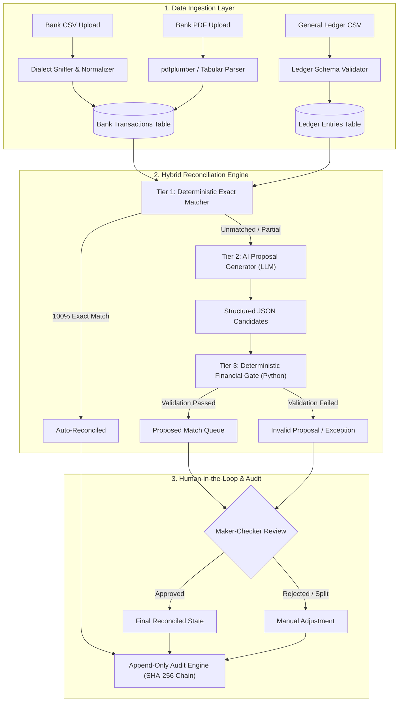
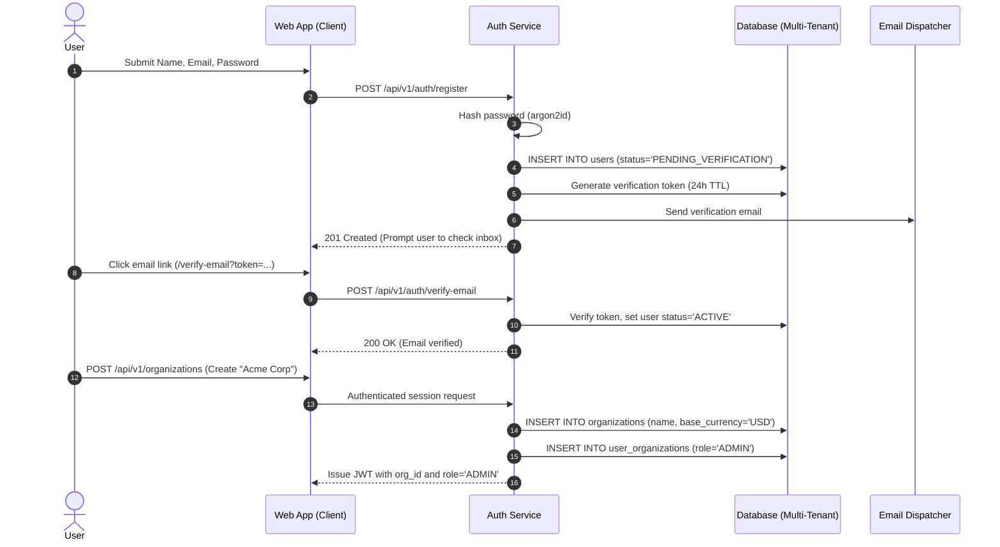
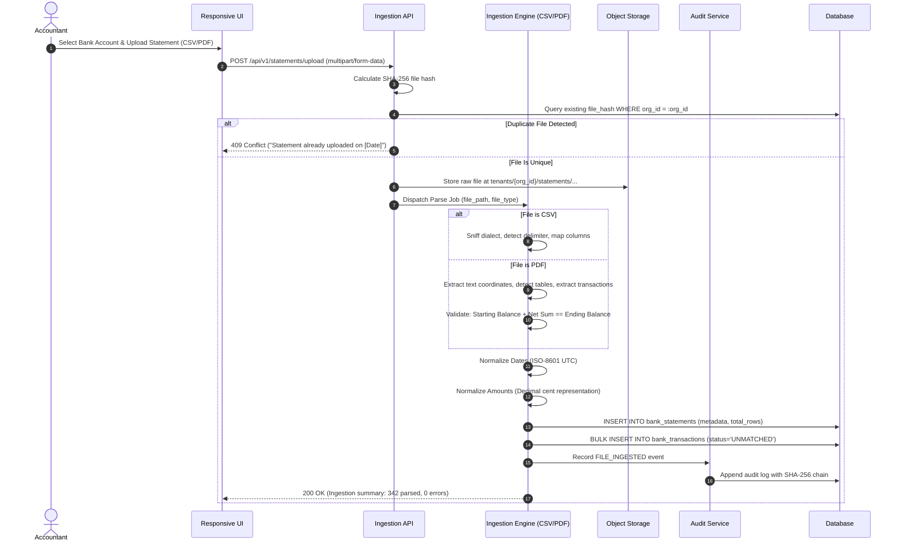
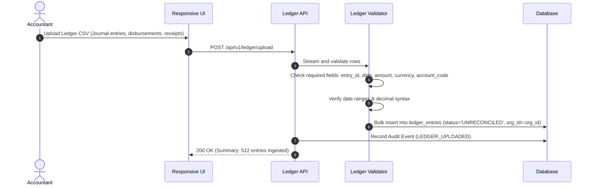
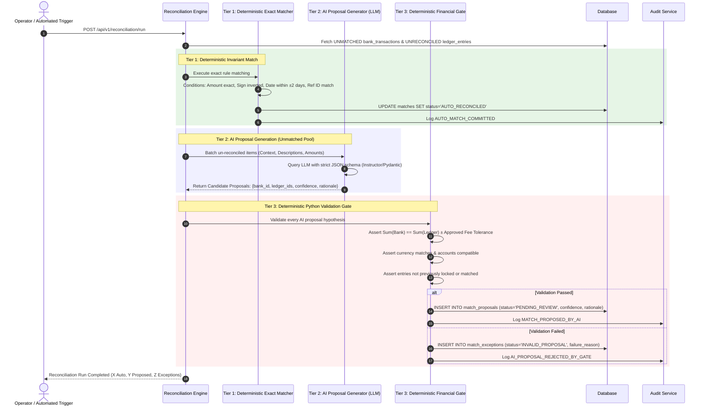
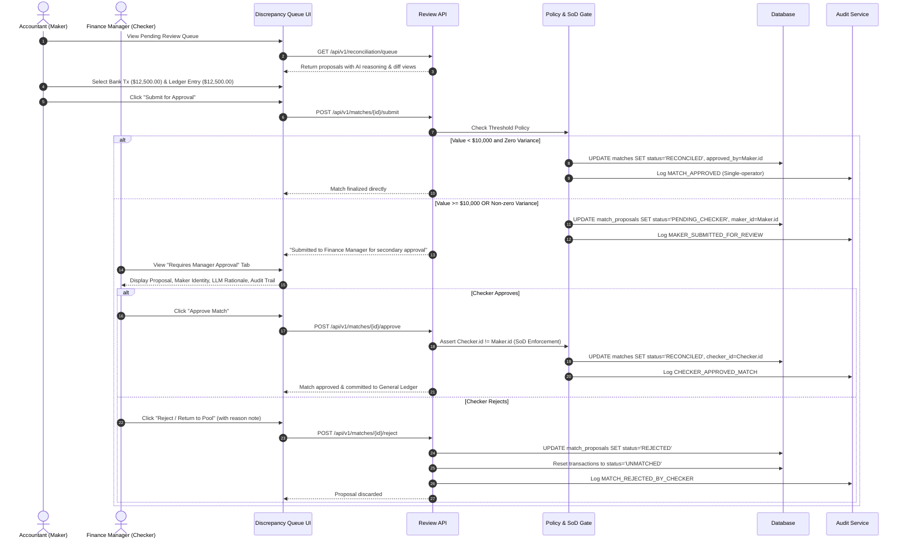
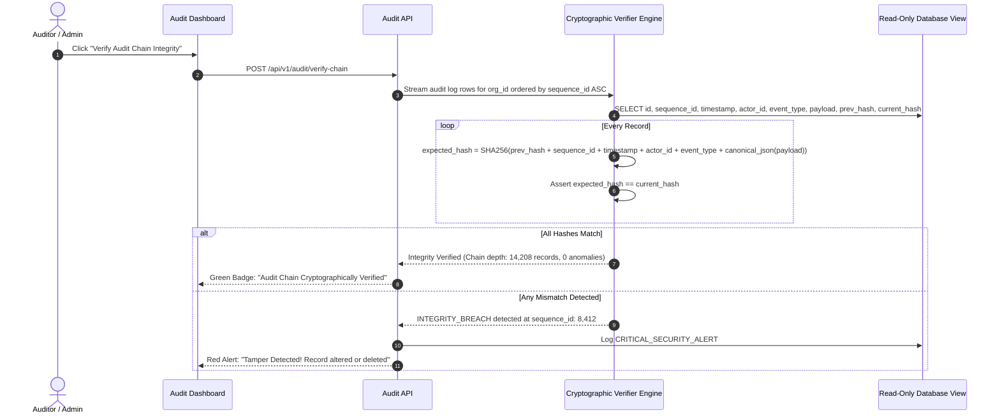

# FinBridge — Core Workflows & System Architecture

**Version**: 1.0.0 (Phase 0 Baseline)  
**Status**: Architecture Approved Blueprint  

---

## 1. End-to-End System Overview

FinBridge processes noisy external banking statements, synchronizes internal accounting ledgers, applies an AI-assisted and deterministic verification pipeline, and guarantees an immutable audit trail.



---

## 2. Detailed Workflows

### 2.1 Workflow 1: User Onboarding & Organization Setup



---

### 2.2 Workflow 2: Bank Statement Ingestion & Normalization

The ingestion pipeline handles both structured CSV files and semi-structured digital PDF statements.



---

### 2.3 Workflow 3: Internal General Ledger CSV Ingestion



---

### 2.4 Workflow 4: Hybrid Two-Tier Reconciliation Pipeline

This is the core intellectual property and architectural differentiator of FinBridge:



---

### 2.5 Workflow 5: Human Review & Maker-Checker Dual Control



---

### 2.6 Workflow 6: Cryptographic Append-Only Audit Trail Verification



---

### 2.7 Workflow 7: Chaos & Integration Failure Simulation

FinBridge incorporates an explicit testing and chaos engine to validate error handling without touching live external banking rails:

```mermaid
sequenceDiagram
    autonumber
    actor Lead as Tech Lead / Tester
    participant UI as Simulation Console
    participant SimEngine as Chaos Simulation Engine
    participant Ingest as Ingestion Service
    participant Audit as Audit Logger

    Lead->>UI: Select Scenario: "ERP Ledger Webhook Network Timeout"
    Lead->>UI: Set Failure Rate = 100%, Target = "Batch Ingest"
    UI->>SimEngine: POST /api/v1/simulations/execute
    SimEngine->>SimEngine: Initialize simulation context (sim_run_id)
    SimEngine->>Ingest: Trigger mock webhook dispatch with artificial latency (35,000ms)
    
    Ingest->>Ingest: Client timeout triggers (HTTP 504 Gateway Timeout)
    Ingest->>Ingest: Circuit Breaker opens; Exponential Backoff retry scheduled (Attempt 1 of 3)
    Ingest->>Audit: Log SIMULATED_FAILURE_CAPTURED (sim_run_id, error="ReadTimeout")
    
    SimEngine->>SimEngine: Evaluate system behavior against resilience invariants:
    Note over SimEngine: Invariant 1: No duplicate records created<br/>Invariant 2: Transactions remain locked in pending state<br/>Invariant 3: Failure logged in structured exception table
    
    SimEngine-->>UI: Simulation Report (Passed: Graceful failure handled, zero data corruption)
```
