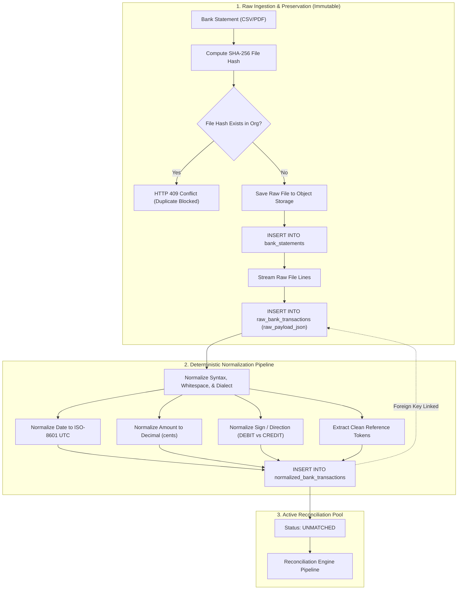
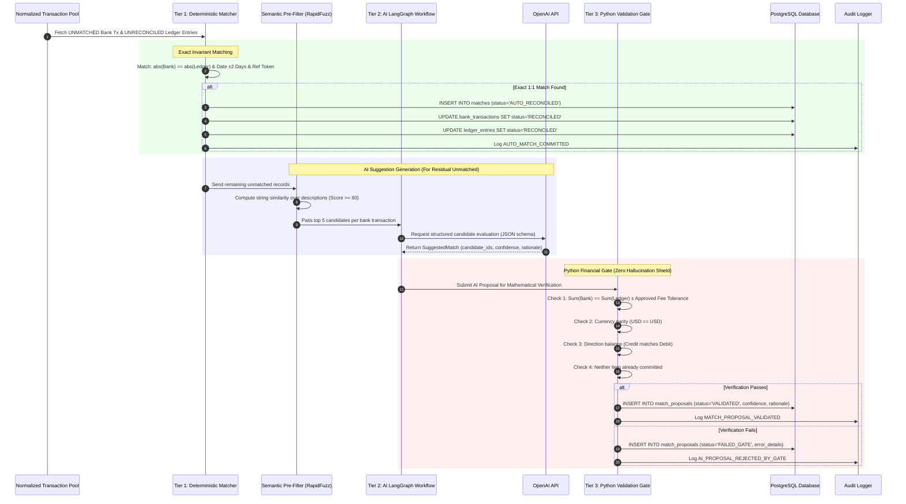
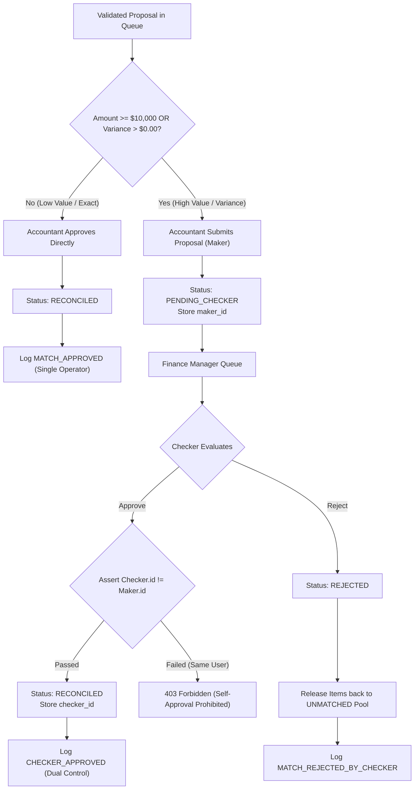
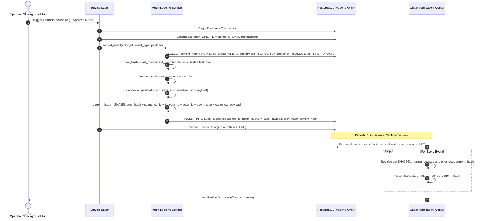

# FinBridge — Data Flow & Lifecycle Specifications

**Version**: 1.0.0 (Phase 1 Baseline)  
**Classification**: Financial Data Lifecycle, State Machines & Pipeline Flows

---

## 1. Raw vs. Normalized Data Lifecycle

A primary tenet of financial compliance is that external statements and internal ledger exports must be preserved in their pristine, unadulterated state. Any transformation into canonical domain models must be traceable back to the exact source row and file offset.



---

## 2. Reconciliation Data Flow & Matching Pipeline

The reconciliation process moves transactions through three deterministic gates, transitioning entities through explicit state boundaries.



---

## 3. Human Review & Maker-Checker State Flow



---

## 4. Cryptographic Audit Event Flow & Verification

Audit records are generated synchronously within the database transaction committing the business state change, guaranteeing that no state mutation can occur without a corresponding audit imprint.



---

## 5. Integration Failure & Chaos Injection Data Flow

```mermaid
sequenceDiagram
    autonumber
    actor Admin as Tester / Architect
    participant ChaosAPI as Chaos Simulation Controller
    participant Interceptor as Network / Client Interceptor
    participant Target as External Adapter (Mock Bank / Mock ERP)
    participant State as System State & Database
    participant Telemetry as Simulation Telemetry Store

    Admin->>ChaosAPI: POST /api/v1/simulations/execute {scenario: "ERP_TIMEOUT", latency_ms: 30000}
    ChaosAPI->>Telemetry: Create simulation_run record (status="RUNNING")
    ChaosAPI->>Interceptor: Arm failure injection flag for sim_context_id
    
    Admin->>ChaosAPI: Trigger ERP Reconciliation Sync
    ChaosAPI->>Interceptor: Dispatch outbound sync request
    Interceptor->>Interceptor: Intercept call: Inject 30,000ms delay & trigger HTTP 504 Timeout
    
    Interceptor-->>ChaosAPI: Raise GatewayTimeoutException
    ChaosAPI->>ChaosAPI: Catch exception; invoke CircuitBreaker & Retry Strategy
    ChaosAPI->>State: Verify Invariant: Zero records marked SYNCED; Transaction rolled back
    
    ChaosAPI->>Telemetry: Log result: {status: "PASSED", invariant_intact: true, retry_scheduled: true}
    ChaosAPI-->>Admin: Return Simulation Execution Report
```
