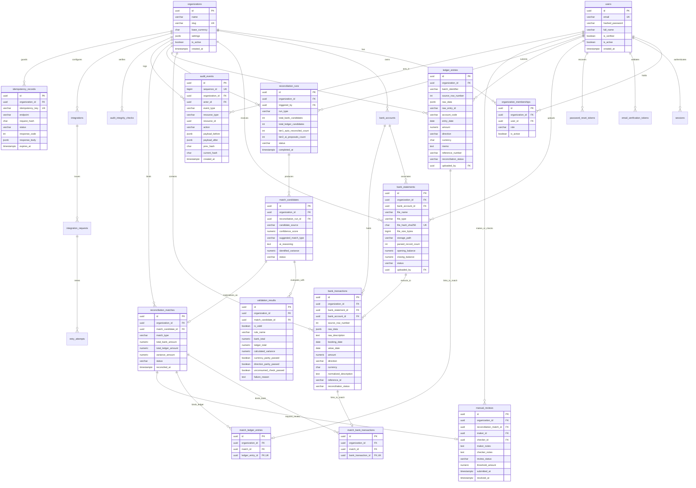

# FinBridge — Entity-Relationship (ER) Architecture

**Version**: 1.0.0 (Phase 2 Baseline)  
**Specification**: Relational Model, Foreign Key Architecture & Multi-Tenant Partitioning

---

## 1. Complete Entity-Relationship (ER) Diagram

---

## 2. Relational Domain Boundaries

### 2.1 The Multi-Tenant Anchor
Every business table contains a non-nullable `organization_id` referencing `organizations(id)`:
- Guarantees logical partitioning at the database engine level.
- Serves as the partition key for Row-Level Security (RLS) policies.
- Prevents cross-organization data leakage even if an application SQL query misses an explicit filter.

### 2.2 Financial Provenance Junction
The relationship between `bank_statements` and `bank_transactions` reflects strict provenance:
- When a statement is uploaded, `bank_statements` records the file's SHA-256 hash.
- Individual transaction lines are extracted into `bank_transactions`.
- Both raw payload strings (`raw_data`, `raw_description`, `raw_amount_string`) and normalized canonical values (`amount`, `direction`, `booking_date`) reside on the record, preserving source fidelity.

### 2.3 The Reconciliation Binding Junction
To prevent a bank transaction or ledger entry from ever participating in two active reconciliations simultaneously:
- `match_bank_transactions` enforces `UNIQUE (bank_transaction_id)`.
- `match_ledger_entries` enforces `UNIQUE (ledger_entry_id)`.
- Reconciling a transaction locks that entity's foreign key in these junction tables, ensuring mathematical uniqueness across 1:1, 1:Many, and Many:1 matches.
