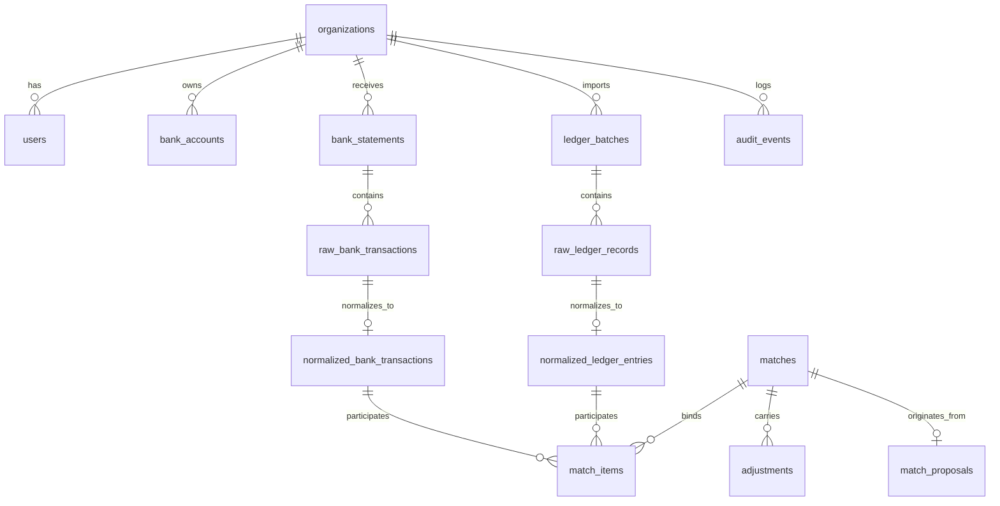
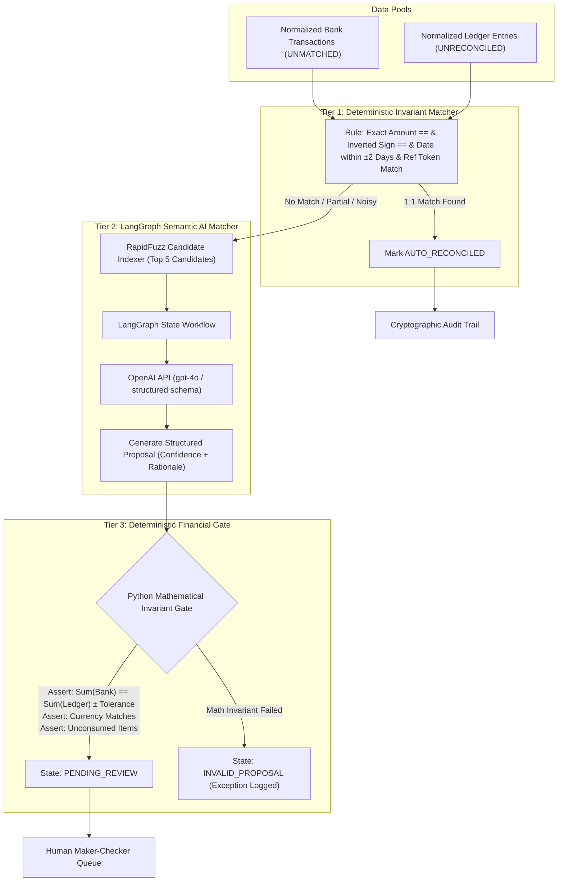
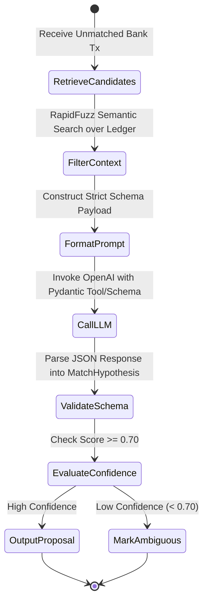
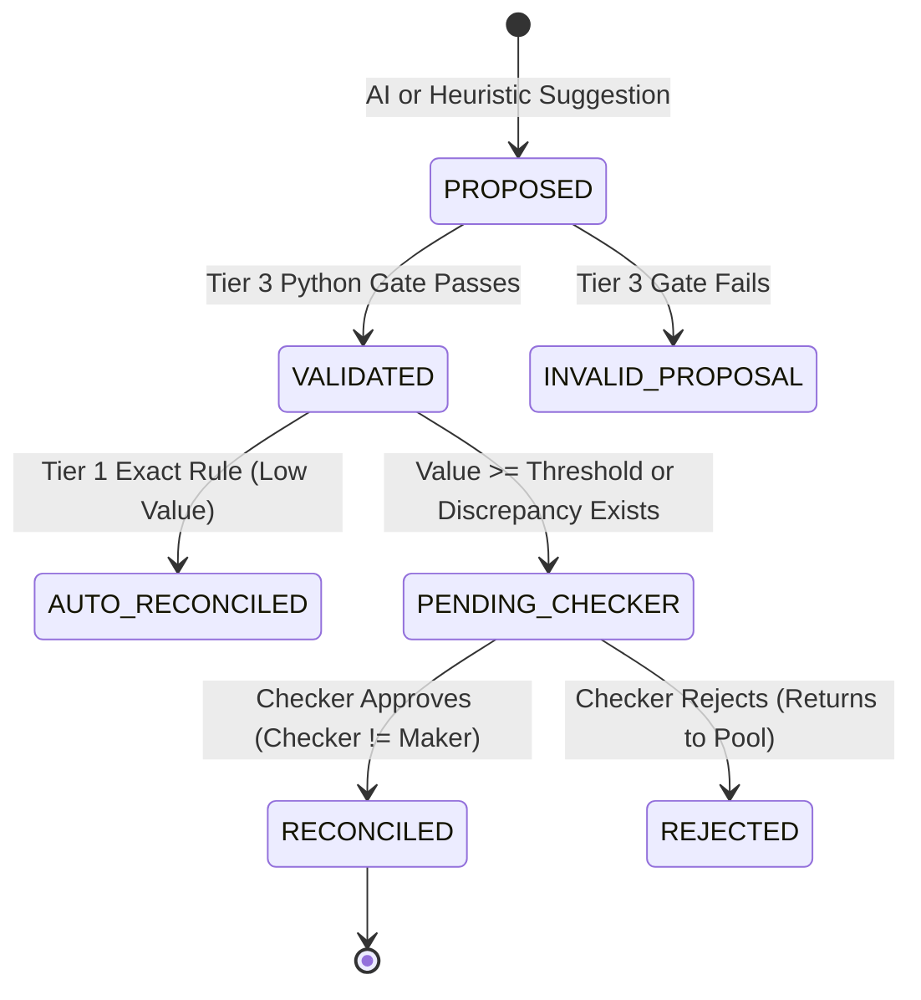

# FinBridge — System Architecture Document

**Version**: 1.0.0 (Phase 1 Baseline)  
**System Classification**: Enterprise Financial Operations & Reconciliation Platform  
**Target Deployment**: Cloud Hybrid (Vercel Frontend, Render Backend, Managed PostgreSQL & Redis)

---

## 1. Executive Architecture Summary

FinBridge is engineered to reconcile noisy, asynchronous external banking records with structured internal general ledger journal entries. The architecture bridges the flexibility of generative artificial intelligence with the zero-tolerance correctness required by financial systems.

The core architectural invariant is the **Hybrid Verification Topology**:
1. **Perception Layer (AI / LangGraph + RapidFuzz)**: Analyzes unstructured narrative descriptions, handles counterparty aliases, and suggests matching topologies (1:1, 1:Many, Many:1).
2. **Deterministic Verification Layer (Python Core)**: Enforces cent-accurate decimal arithmetic, strict sign inversions, currency parity, date-window tolerances, and single-consumption constraints.
3. **Control & Governance Layer (Maker-Checker + Cryptographic Audit)**: Enforces separation of duties for high-value transactions and guarantees tamper-evident logging via SHA-256 hash chaining.

```
                              ┌────────────────────────────────────────┐
                              │            Client Browser              │
                              │    React 18 + TypeScript + Vite        │
                              │           (Hosted on Vercel)           │
                              └───────────────────┬────────────────────┘
                                                  │ HTTPS / WSS
                                                  ▼
                              ┌────────────────────────────────────────┐
                              │           FastAPI Gateway              │
                              │        Python 3.12+ / Uvicorn          │
                              │          (Hosted on Render)            │
                              └─────────┬───────────────────┬──────────┘
                                        │                   │
                        Enqueues Tasks  │                   │ Queries / Mutates
                                        ▼                   ▼
     ┌─────────────────────────────────────┐     ┌─────────────────────────────────────┐
     │            Redis 7+                 │     │          PostgreSQL 16+             │
     │  - Celery Broker & Result Backend   │     │  - Relational Normalized Ledger     │
     │  - Idempotency Cache                │     │  - Raw Immutable Document Store     │
     │  - Rate Limiter & Session Blacklist │     │  - Append-Only Hash-Chained Audit   │
     └──────────────────┬──────────────────┘     └──────────────────▲──────────────────┘
                        │                                           │
         Pulls Tasks    │                                           │ Writes Reconciled
                        ▼                                           │ & Audit State
     ┌──────────────────────────────────────────────────────────────┴──────────────────┐
     │                        Celery Worker Cluster (Render)                           │
     │  ┌───────────────────────┐ ┌───────────────────────┐ ┌───────────────────────┐  │
     │  │   Ingestion Worker    │ │  Reconciliation Core  │ │  AI LangGraph Worker  │  │
     │  │ (pdfplumber / Pandas) │ │   (Tier 1 & Tier 3)   │ │  (OpenAI Structured)  │  │
     │  └───────────────────────┘ └───────────────────────┘ └───────────────────────┘  │
     └─────────────────────────────────────────────────────────────────────────────────┘
```

---

## 2. Component Design & Deep Dive

### 2.1 Frontend Architecture
- **Framework**: React 18+ with TypeScript (Strict mode enabled).
- **Build Tooling**: Vite with ESBuild for sub-second hot module replacement.
- **Styling**: Tailwind CSS with custom design tokens for financial tables, density switches (compact vs comfortable), and WCAG 2.1 AA accessible contrast ratios.
- **State Management**:
  - *Server State*: TanStack Query (React Query v5) for query caching, automatic revalidation, optimistic updates on manual matching, and mutation rollbacks.
  - *Client / Session State*: Zustand for local layout state (sidebar collapse, active filter presets, discrepancy queue sorting).
- **Component Hierarchy**:
  - `Layout`: Responsive shell with desktop sidebar, tablet collapsible drawer, and mobile bottom nav.
  - `IngestionConsole`: Drag-and-drop file upload with real-time parsing progress, column mapping modal, and raw-vs-normalized diff preview.
  - `ReconciliationWorkstation`: Split-screen comparison grid (Bank Statements on Left, General Ledger on Right) with interactive linking, confidence score pills, and discrepancy action bars.
  - `ReviewQueue`: Maker-Checker approval portal with role-based action gating (Approve, Reject, Split, Escalate).
  - `AuditExplorer`: Cryptographic chain inspector with real-time hash verification badge and timeline filtering.
  - `ChaosConsole`: Simulation trigger panel with interactive fault injection dials.

---

### 2.2 Backend Architecture (FastAPI & Clean Architecture)
The backend is structured according to Clean Architecture / Hexagonal Architecture principles:

```
backend/
├── app/
│   ├── api/                    # Presentation Layer (FastAPI Routers, Dependencies)
│   │   ├── v1/
│   │   │   ├── endpoints/      # Auth, Ingestion, Matching, Audit, Simulation
│   │   │   └── api_router.py
│   │   └── deps.py             # Security, DB session, Tenant context injectors
│   ├── core/                   # Cross-cutting concerns
│   │   ├── config.py           # Pydantic v2 BaseSettings
│   │   ├── security.py         # Argon2id, JWT encode/decode
│   │   ├── logging.py          # Structlog JSON configuration
│   │   └── middleware.py       # TenantContext, CorrelationId, Idempotency
│   ├── domain/                 # Pure Business Domain (Zero external dependencies)
│   │   ├── models/             # Domain entities (immutable dataclasses)
│   │   ├── rules/              # Financial invariant rules (Python Decimal)
│   │   └── exceptions.py       # Domain-specific financial exceptions
│   ├── services/               # Application Orchestration Layer
│   │   ├── ingestion/          # CSV & PDF extraction services
│   │   ├── reconciliation/     # Tier 1 exact matcher, Tier 3 validation gate
│   │   ├── ai/                 # LangGraph workflow, OpenAI schema binder
│   │   ├── audit/              # Cryptographic hash-chain writer & verifier
│   │   └── simulation/         # Chaos fault injection harness
│   ├── infrastructure/         # External Adapters & Persistence
│   │   ├── db/                 # SQLAlchemy 2.0 Async engine, models, session
│   │   ├── storage/            # Local disk / S3 blob adapter for raw files
│   │   └── celery_tasks/       # Background job definitions
│   └── main.py                 # ASGI entrypoint
├── alembic/                    # DB migration scripts
└── tests/                      # Pytest, Hypothesis, and integration tests
```

---

### 2.3 Database Architecture (PostgreSQL 16+)

#### Critical Separation: Raw Source Data vs. Normalized Transactions
To adhere to financial auditability standards, external files and internal ledger imports are never overwritten or mutated. Raw data is ingested into immutable "Raw" tables, while the system derives canonical "Normalized" entities for matching.



#### Core Schema Tables:
1. `organizations`: Tenant root (`id`, `name`, `base_currency`, `settings_json`, `created_at`).
2. `users`: System users (`id`, `email`, `hashed_password`, `full_name`, `status`, `is_verified`).
3. `user_organizations`: Role association (`user_id`, `organization_id`, `role` enum: `ADMIN`, `FINANCE_MANAGER`, `ACCOUNTANT`, `AUDITOR`).
4. `bank_statements`: File metadata (`id`, `organization_id`, `bank_account_id`, `file_name`, `file_hash_sha256`, `storage_path`, `file_type`, `total_records`, `status`).
5. `raw_bank_transactions`: Untouched line item dump (`id`, `statement_id`, `organization_id`, `line_number`, `raw_payload_json`, `created_at`).
6. `normalized_bank_transactions`: Canonical representation (`id`, `raw_tx_id`, `organization_id`, `bank_account_id`, `booking_date`, `value_date`, `amount`, `currency`, `direction` [DEBIT/CREDIT], `description_normalized`, `reference_id`, `reconciliation_status`).
7. `raw_ledger_records`: Untouched ledger export (`id`, `batch_id`, `organization_id`, `raw_payload_json`).
8. `normalized_ledger_entries`: Standardized ledger (`id`, `raw_record_id`, `organization_id`, `account_code`, `entry_date`, `amount`, `currency`, `direction`, `memo`, `reconciliation_status`).
9. `matches`: Confirmed reconciliations (`id`, `organization_id`, `match_type` [EXACT_1_1, SPLIT_1_N, CONSOLIDATED_N_1], `variance_amount`, `maker_id`, `checker_id`, `status` [AUTO_RECONCILED, PENDING_CHECKER, RECONCILED, REJECTED], `created_at`, `finalized_at`).
10. `match_items`: Associative join table linking `matches` to `normalized_bank_transactions` and `normalized_ledger_entries`.
11. `match_proposals`: Hypotheses generated by AI/heuristics (`id`, `organization_id`, `bank_tx_id`, `candidate_ledger_ids_json`, `confidence_score`, `llm_reasoning`, `status` [PENDING, VALIDATED, FAILED_GATE, DISCARDED]).
12. `audit_events`: Append-only tamper-evident log (`id`, `sequence_id`, `organization_id`, `actor_id`, `event_type`, `resource_type`, `resource_id`, `payload_json`, `prev_hash`, `current_hash`, `timestamp`).

---

### 2.4 Authentication & Authorization Architecture
- **Password Hashing**: `argon2id` (memory_cost=65536, time_cost=3, parallelism=4).
- **Access Tokens**: Short-lived JWTs (15-minute TTL) signed via `RS256` or `Ed25519`. Claims include `sub` (user_id), `org_id` (current tenant), and `role`.
- **Refresh Tokens**: Long-lived (7-day TTL), cryptographically random 256-bit entropy tokens stored in HTTP-only, SameSite=Strict cookies. Stored in Redis with automatic rotation and token family invalidation upon reuse detection.
- **Tenant Context Injection**: A FastAPI dependency extracts `org_id` from the validated token, asserts membership and role in `user_organizations`, and binds the tenant context to a Python `contextvars.ContextVar`.

---

### 2.5 Multi-Tenant Isolation Architecture
FinBridge employs **Defense-in-Depth Multi-Tenancy**:
1. **API / Middleware Level**: Every incoming request must provide an active organization context. If a user attempts to access a resource with an invalid `org_id`, the request is rejected with `403 Forbidden`.
2. **Service / ORM Level**: Base SQLAlchemy repository patterns automatically append `WHERE organization_id = :tenant_id` to all queries, updates, and deletes.
3. **Database Level (PostgreSQL RLS)**: Tables have Row-Level Security enabled. The database connection sets `SET LOCAL app.current_org_id = :tenant_id`. Any query attempting to bypass application filters is blocked at the PostgreSQL engine level.
4. **Cache & Queue Isolation**: Redis keys are namespaced: `tenant:{org_id}:idempotency:{key}` and `tenant:{org_id}:cache:...`.

---

### 2.6 Hybrid Reconciliation Engine (Three-Tier Pipeline)



#### Invariants Enforced by Tier 3 Python Gate:
- `Rule 1`: Absolute monetary sum of bank items must equal the absolute monetary sum of ledger items within configured fee tolerance:
  $$\left| \sum \text{Bank.Amount} - \sum \text{Ledger.Amount} \right| \le \text{MaxAllowedVariance}$$
- `Rule 2`: Currency codes must be identical (e.g., USD == USD).
- `Rule 3`: Transaction directionality must balance (Bank Debit matches Ledger Credit; Bank Credit matches Ledger Debit).
- `Rule 4`: Zero-consumption invariant: Neither the bank transaction nor the ledger entry may already have a confirmed match link.

---

### 2.7 AI Workflow Architecture (LangGraph + OpenAI Structured Outputs)
The AI suggestion subsystem is orchestrated via **LangGraph**, preventing unbounded LLM loops and enforcing deterministic boundaries:



- **Pydantic Schema for Structured Output**:
```python
class SuggestedMatch(BaseModel):
    bank_tx_id: UUID
    candidate_ledger_ids: list[UUID]
    confidence_score: float = Field(ge=0.0, le=1.0)
    match_category: Literal["EXACT_SEMANTIC", "SPLIT_FEE", "TIMING_LAG", "PARTIAL_PAYMENT"]
    identified_fee_amount: Decimal = Field(default=Decimal("0.00"))
    counterparty_detected: str
    reasoning: str
```

---

### 2.8 Human Approval Workflow & Maker-Checker Dual Control
- **Standard Threshold**: Configurable per tenant (Default: $\$10,000.00$ or any match with non-zero variance).
- **Maker Role (`Accountant`)**: Investigates proposals, confirms split matches, drafts variance adjustments, and submits proposal to review.
- **Checker Role (`Finance Manager`)**: Dedicated approval queue. The system enforces:
  $$\text{Checker.user\_id} \neq \text{Maker.user\_id}$$
- **State Machine for Matches**:


---

### 2.9 Cryptographic Audit Architecture
Every state mutation creates an immutable audit row:
$$H_n = \text{SHA256}(H_{n-1} \parallel \text{seq\_id} \parallel \text{timestamp} \parallel \text{actor\_id} \parallel \text{event\_type} \parallel \text{canonical\_json}(\text{payload}))$$

- The database role assigned to the web application has `REVOKE UPDATE, DELETE ON audit_events` privileges. Records can only be inserted.
- A background Celery job runs hourly to verify hash continuity across all tenants. If $H_n \neq \text{computed\_hash}$, a critical alert is triggered.

---

### 2.10 Integration Reliability & Chaos Simulator
- **Idempotency**: All mutation endpoints accept an `X-Idempotency-Key` header. Keys are cached in Redis with request status (`PROCESSING`, `COMPLETED`, `FAILED`) and a 24-hour TTL.
- **Chaos Injection Harness**:
  - Simulates network timeouts (504), ERP 500 errors, partial batch failures, and webhook duplicate replays.
  - Test suites and interactive testing consoles allow developers to trigger faults and observe automated circuit breaking, exponential backoff retries, and rollback integrity.

---

### 2.11 Background Job Architecture (Celery + Redis)
- **Queue Segmentation**:
  1. `high_priority`: Auth emails, immediate user-triggered manual single matches.
  2. `ingestion_queue`: Large CSV parsing, PDF coordinate extraction and tabular OCR.
  3. `reconciliation_queue`: Batch Tier 1 deterministic sweeps.
  4. `ai_queue`: Rate-limited LangGraph + OpenAI API workers (concurrency limited to match OpenAI TPM/RPM quotas).
  5. `audit_queue`: Cryptographic chain verification and compliance report generation.

---

### 2.12 Monitoring, Telemetry & Structured Logging
- **Structured Logging**: `structlog` emitting standardized JSON events with `correlation_id`, `organization_id`, `actor_id`, and `duration_ms`.
- **Metrics**: Prometheus instrumentation exposing:
  - `reconciliation_auto_match_ratio` (Target > 75%)
  - `tier3_gate_rejection_count` (Detects bad AI proposals)
  - `ingestion_duration_seconds` (Histogram by file size)
  - `celery_task_latency_seconds`
- **Health Checks**:
  - `/health/live`: Fast liveness probe (checks process responsiveness).
  - `/health/ready`: Deep readiness probe (checks PostgreSQL connection pool, Redis ping, and Celery broker reachability).
